# PlEpiSeq WGS Pipeline Documentation

Michał Kadlof, Michał Łaźniewski

The document provides technical documentation for the bioinformatics processing protocols (also known as pipelines) developed in the PlEpiSeq project. These protocols are designed for the automatic analysis of SARS-CoV-2, influenza, and RSV viruses and Salmonella, Escherichia and Campylobacter genera sequenced using Illumina and Nanopore technologies. It covers the architecture, installation and execution procedures, the content of the Nextflow modules, and details of the validation tests.

> **Status of this document.** This text was written for the pipeline as it
> stood in **February 2026** and has not yet been fully revised for release
> **1.8.0**. Chapters 1, 2 and 5 have been corrected; chapters 3, 4, 6 and 7 may
> still describe earlier behaviour. Where this document disagrees with
> `README.md`, with `CHANGELOG.md`, or with the `--help` output of the wrapper
> scripts, **the code is authoritative**. Known defects are tracked in `TODO.md`.
>
> Notable features added after this document was written, and therefore missing
> from it: cuteSV structural-variant calling for Nanopore SARS-CoV-2 and RSV;
> RSV F-protein resistance analysis (nirsevimab, palivizumab, clesrovimab);
> bacterial pHierCC/HierCC assignment; the EQA2026 primer schemes and the new
> RSV-A/RSV-B references; the `run_pipeline.sh` dispatcher; and the `--debug`
> flag on both wrappers.

## Table of Contents

- [1. Conventions in this document](#1-conventions-in-this-document)
  - [1.1. Paragraphs styles:](#11-paragraphs-styles)
  - [1.2. Character styles:](#12-character-styles)
  - [1.3. Paths](#13-paths)
- [2. Quick start](#2-quick-start)
  - [2.1. Prerequisites](#21-prerequisites)
  - [2.2. Installation](#22-installation)
  - [2.3. Running the viral pipeline](#23-running-the-viral-pipeline)
  - [2.4. Running the bacterial pipeline](#24-running-the-bacterial-pipeline)
- [3. Hardware requirements](#3-hardware-requirements)
  - [3.1. CPU](#31-cpu)
  - [3.2. GPU](#32-gpu)
  - [3.3. Memory](#33-memory)
  - [3.4. Storage requirements](#34-storage-requirements)
- [4. Pipeline overview](#4-pipeline-overview)
  - [4.1. Modules for Specific Functionalities](#41-modules-for-specific-functionalities)
  - [4.2. Channels for Connectivity](#42-channels-for-connectivity)
  - [4.3. Workflow Construction](#43-workflow-construction)
  - [4.4. Organization of modules and workflows in the repository](#44-organization-of-modules-and-workflows-in-the-repository)
  - [4.5. Flowcharts](#45-flowcharts)
- [5. External and Internal data](#5-external-and-internal-data)
  - [5.1. Downloading the Data](#51-downloading-the-data)
  - [5.2. Updating the data](#52-updating-the-data)
  - [5.3. Database structure](#53-database-structure)
  - [5.4. External Datasets utilized by the program](#54-external-datasets-utilized-by-the-program)
  - [5.5. Internal Datasets utilized by the program](#55-internal-datasets-utilized-by-the-program)
- [6. Running pipeline](#6-running-pipeline)
  - [6.1. Running the viral pipeline](#61-running-the-viral-pipeline)
  - [6.2. Running the bacterial pipeline](#62-running-the-bacterial-pipeline)
- [7. Modules](#7-modules)
  - [7.1. Module alphafold.nf (viral)](#71-module-alphafoldnf-viral)
  - [7.2. Module bwa.nf](#72-module-bwanf)
  - [7.3. Module coinfection_analysis.nf](#73-module-coinfection_analysisnf)
  - [7.4. Module coinfection_ivar.nf](#74-module-coinfection_ivarnf)
  - [7.5. Module coinfection_varscan.nf](#75-module-coinfection_varscannf)
  - [7.6. Module consensus.nf](#76-module-consensusnf)
  - [7.7. Module copy_genome_and_primers.nf](#77-module-copy_genome_and_primersnf)
  - [7.8. Module dehumanization.nf](#78-module-dehumanizationnf)
  - [7.9. Module detect_subtype_nanopore.nf](#79-module-detect_subtype_nanoporenf)
  - [7.10. Module detect_subtype.nf](#710-module-detect_subtypenf)
  - [7.11. Module detect_type.nf](#711-module-detect_typenf)
  - [7.12. Module fastqc.nf](#712-module-fastqcnf)
  - [7.13. Module filtering_multiple_segments.nf](#713-module-filtering_multiple_segmentsnf)
  - [7.14. Module filtering_one_segment.nf](#714-module-filtering_one_segmentnf)
  - [7.15. Module filter_out_non_SNPs.nf](#715-module-filter_out_non_snpsnf)
  - [7.16. Module freeBayes.nf](#716-module-freebayesnf)
  - [7.17. Module freyja.nf](#717-module-freyjanf)
  - [7.18. Module indelQual.nf](#718-module-indelqualnf)
  - [7.19. Module integrate_medaka_and_varscan.nf](#719-module-integrate_medaka_and_varscannf)
  - [7.20. Module json_aggregator.nf](#720-module-json_aggregatornf)
  - [7.21. Module kraken2.nf](#721-module-kraken2nf)
  - [7.22. Module lofreq.nf](#722-module-lofreqnf)
  - [7.23. Module lowCov.nf](#723-module-lowcovnf)
  - [7.24. Module make_genome_from_vcf.nf](#724-module-make_genome_from_vcfnf)
  - [7.25. Module manta.nf](#725-module-mantanf)
  - [7.26. Module masking.nf](#726-module-maskingnf)
  - [7.27. Module medaka.nf](#727-module-medakanf)
  - [7.28. Module merging_nanopore.nf](#728-module-merging_nanoporenf)
  - [7.29. Module merging_one_segment_filtering.nf](#729-module-merging_one_segment_filteringnf)
  - [7.30. Module minimap2.nf](#730-module-minimap2nf)
  - [7.31. Module nextalign.nf](#731-module-nextalignnf)
  - [7.32. Module nextclade.nf](#732-module-nextcladenf)
  - [7.33. Module pangolin.nf](#733-module-pangolinnf)
  - [7.34. Module picard.nf](#734-module-picardnf)
  - [7.35. Module picard_wgsMetrics.nf](#735-module-picard_wgsmetricsnf)
  - [7.36. Module reassortment.nf](#736-module-reassortmentnf)
  - [7.37. Module resistance.nf](#737-module-resistancenf)
  - [7.38. Module snpEff.nf](#738-module-snpeffnf)
  - [7.39. Module sort_and_index.nf](#739-module-sort_and_indexnf)
  - [7.40. Module substitute_ref.nf](#740-module-substitute_refnf)
  - [7.41. Module trimmomatic.nf](#741-module-trimmomaticnf)
  - [7.42. Module varscan.nf](#742-module-varscannf)
  - [7.43. Module vcf_from_fasta.nf](#743-module-vcf_from_fastanf)
- [8. JSON output](#8-json-output)
- [9. Appendix A Primers](#9-appendix-a-primers)
- [10. Appendix B History](#10-appendix-b-history)

# 1. Conventions in this document

Following styles are used in this document:

## 1.1. Paragraphs styles:

Normal paragraphs are written with Text Body. The examples of code are presented in a gray box

```
Some code
```

## 1.2. Character styles:

1.  Paths are denoted like here /usr/bin/bash with path style

2.  Inline Code is inserted with code character style like this, --no-cache and it's pretty nice

3.  Useful tips are colored green

Do you know this code can be executed with -very-special-and-hidden option? This will speed up calculations a hundred fold!

4.  Errors and warnings are in re box

The program only operates on Unix based systems

## 1.3. Paths

All paths in this documentation are relative to User’s home directory “~/”. Thus, if you see a command like this:

```bash
cp plepiseq-wgs-pipeline/docker/Dockerfile-alphafold alphafold/docker/Dockerfile
```

it actually represents:

```bash
cp /home/my_user_name/plepiseq-wgs-pipeline/docker/Dockerfil-alphafold \
/home/my_user_name /alphafold/docker/Dockerfile
```

Thus, copy pasting commands from Code Box directly to the terminal, without any adjustments, is highly discouraged.

# 2. Quick start

## 2.1. Prerequisites

1.  GNU/Linux computing server with x86_64 architecture and at least one GPU unit (recommended Nvidia A100 with 80Gb of VRAM or newer). The pipeline was tested on servers with following operational systems Ubuntu 20.04.06 LTS, Ubuntu 24.04.2 LTS, and Debian 12.5. Pipeline was never tested on Windows operating system and will likely not work, unless executed via WSL2 (windows subsystem linux).

2.  User must have sudo privileges, and must be added to the docker group.

3.  Docker (<https://docs.docker.com/desktop/install/linux-install>). The pipeline was tested on docker version 24.0.7 and 27.3.1.

4.  Nexflow (<https://www.nextflow.io/docs/latest/install.html>) with the nextflow binary file located in a directory that is in the PATH variable. One can copy nextflow binary to e.g. /usr/local/bin

```bash
sudo mv nextflow /usr/local/bin
```

The pipeline was tested on nextflow version 24.10.3.5933, 24.04.4.5917, and 24.10.4.5934.

5.  Nextflow config (<https://www.nextflow.io/docs/latest/config.html>). The config defines which nextflow executors are available, and adjust their default parameters to work best on a given machine. Below is the sample config modifying two in-build nexflow executors *slurm* and *local*. If put in ~/.nextflow/config this config will be visible for nexflow regardless where *nextflow* command is executed.

```groovy
// definition of profiles accessible to nextflow
profiles {
local {
// creates a profile called "local".
process.executor = 'local' // name of the executor used by this profile
process.errorStrategy = 'retry' // all modules in the pipeline executed using this profile are resubmitted if they fail
process.maxRetries = 2 // number of times nexflow retries to execute a module
}
slurm {
// create a profile called "slurm". It uses nextflow's "slurm" executor.
process.executor = 'slurm'
process.clusterOptions = '--nodelist=HOSTNAME1,HOSTNAME2' // sbatch option list of node(s) available to slurm executor
process.errorStrategy = 'retry'
process.maxRetries = 2
}
}
executor {
// Here we modify default behavior of the executors (as named in a previous section)
$local {
cpus = X // number of CPUs allocated to all processes e.g. 100
memory = 'Y GB' // amount of RAM allocated to all processes e.g. '5 Gb'
}
$slurm {
queueSize = Z // amount of processes allowed in slurm queue
}
}
// "Global" modifiers
docker.enabled = true // allow execution of processes inside docker containers. **MUST BE** true
params.enterobase_api_token = 'SECRET_KEY' // a valid Enterobase API key required by some modules. VALID key **MUST BE** set when analyzing bacterial WGS data
```

6.  Repository with the pipeline. To download latest version repository type

```bash
git clone --depth 1 https://github.com/BioinfoPZH/plepiseq-wgs-pipeline.git
```

7.  **Specific** version of Alphafold2 repository. Download Alphafold2 and switch to a predefined commit.

```bash
git clone https://github.com/google-deepmind/alphafold.git
cd alphafold
git reset --hard 9b2ed02
```

We pin to this revision because later commits replaced several scipy-based functions with JAX equivalents. Some of the replacement functions are only available in **JAX ≥ 0.4.31**, while the repository’s pinned dependencies (at the time of writing) use an older JAX version (0.4.29). This mismatch can cause runtime errors. Until upstream dependency pins and code are consistent again, we recommend using this older AlphaFold2 snapshot (October 2025).

8.  \[**optional**\] Slurm - a system workload manager (https://slurm.schedmd.com/). A program used by nextflow to distribute jobs between multiple nodes in a multiple server setup. Installation of this program is beyond the scope of this documentation. Slurm is not required to run our pipeline but it allows for independent execution of multiple nextflow jobs .

## 2.2. Installation

1)  In the directory with the main repository (2.1.6), create a credentials file based on the `sample_credentials.txt` template. It holds the API keys used to connect to the EnteroBase and PubMLST services, and its path is passed to `update_external_databases.sh` with `--credentials_file`. The script mounts it into the updater container as `/home/update/credentials.txt`.

```bash
cp sample_credentials.txt credentials.txt
# then edit credentials.txt and fill in the keys
```

To obtain a valid EnteroBase token please consult <https://enterobase.readthedocs.io/en/latest/api/about-the-api.html>

The EnteroBase key is valid for 6 months. When it expires, edit the credentials file — no container rebuild is needed, because the file is mounted at run time rather than baked into the image. Keep the file outside version control; `bin/update/credentials.txt` is listed in `.gitignore`.

Credentials are required for the `enterobase`, `pubmlst`, `cgmlst`, `mlst` and `all` database targets. Databases used only by the viral pipeline can be updated without them.

Note that a valid `params.enterobase_api_token` in the nextflow config is a separate requirement: the credentials file is used by the database updater, whereas the config token is used at run time by the bacterial pHierCC module.

2)  Enter the repository and build all docker images used by the pipeline. In the following chapters we **assume the images are named as in the example below.** These names are also defaults in most downstream/helper scripts.

```bash
cd plepiseq-wgs-pipeline
docker build --target main -f docker/Dockerfile-viral -t plepiseq-wgs-pipeline-viral:latest .
docker build --target manta -f docker/Dockerfile-manta -t plepiseq-wgs-pipeline-manta:latest .
docker build --target updater -f docker/Dockerfile-viral -t plepiseq-wgs-pipeline-updater:latest .
docker build -f docker/Dockerfile-bacterial -t plepiseq-wgs-pipeline-bacterial:latest .
```

You may add --no-cache flag to docker build command to avoid caching effects.

---

In case you are using corporate network with its own set of certificates, you may encounter a “certificate verify failed“ error during the building process. In that case, add the following flag to the “docker build” command: --build-arg CERT_FILE="\$(cat corporate-certificate.crt)". The .crt files contains a network certificate provided by your network administrator.

---

You may check what images are available on your server after by typing docker images

---

To better track changes to the versions of our pipeline one can build an image using following command:

```bash
docker build -f docker/Dockerfile-bacterial -t plepiseq-wgs-pipeline-bacterial:latest -t plepiseq-wgs-pipeline-bacterial:$(cat VERSION) .
```

3)  Got to the Alphafold2 repository, **replace** the original Dockerfile (located in the docker/ subdirectory) with the dockerfile provided by our repository (file is also called Dockerfile and is located in subdirectory called plepiseq-wgs-pipeline/docker/). This change is required for the alphafold2 program to work within the nextflow framework.

**Consult installation instruction on https://github.com/google-deepmind/alphafold for alphafold2 prerequisites.**

```bash
cd alphafold
cp ../plepiseq-wgs-pipeline/docker/Dockerfile-alphafold alphafold/docker/Dockerfile
```

Build the Alphafold2 docker image in a directory with the Alphafold2 repository. This command must be executed in the main directory of the alphafold2 repository.

```bash
docker build -f docker/Dockerfile -t plepiseq-wgs-pipeline-alphafold:latest .
```

download the weights used alphafold2.

```bash
scripts/download_alphafold_params.sh <DOWNLOAD_DIR>
```

Since version 1.2.0 proposing protein structures with Alphafold2 is an **optional** feature. You can skip Alphafold2 installation if you don not plan to use this feature.

4)  Download the image with the medaka program, available on docker hub. We use a specific version of the medaka program, hence the long tag. Do not use the image with “latest” tag. We decided to pin specific version as medaka vocabulary sometimes changes between the program’s versions.

```bash
docker pull ontresearch/medaka:sha447c70a639b8bcf17dc49b51e74dfcde6474837b-amd64
```

5)  Download the latest image of the prokka program.

```bash
docker pull staphb/prokka
```

6)  Download the latest versions of the “external” databases, essential to run the pipeline (see Chapter 6 for details). A shell wrapper for this specific task is provided in the pipeline’s repository (a file called “update_external_databases.sh”). This script can be run in two modes (a) to download all the databases or (b) to download only a specific database.

1.  Create a directory where all external dabases are located

```bash
mkdir -p /path/to/external_databases
```

2.  Move the alphafold2 required data (downloaded in 2.2.2) to a specific directory within external databases called alphafold /path/to/external_databases/alphafold/

3.  Downloading all the databases. Type

```bash
./update_external_databases.sh --database all --output-path /path/to/external_databases
```

If directory specified with --output-path exists the program will overwrite data in some directories. We recommend using an empty directory to store external databases.

The process of downloading all databases can take a long time up to 2 days. This is mostly the consequence of a limit in number of queries a user can send to pubmlst and enterobase databases.

In PZH the default location is **/mnt/raid/external_databases** and this path is used as **default** by many downstream scripts and programs. Adjust downstream program and scripts if you use a different path.

4.  Databases can be downloaded separately. To download only a specific database type e.g.

```bash
./update_external_databases.sh --database pangolin --output /path/to/external_databases
```

OR

```bash
./update_external_databases.sh --database kraken2 --output /path/to/external_databases
```

Consult Chapter 5 to get more information regarding external databases used by our pipeline.

You can type ./update_external_databases.sh -h to see the list of all downloadable databases.

## 2.3. Running the viral pipeline

1)  To run the viral pipeline it is **recommended** to use a shell wrapper located in the pipeline’s main directory called “run_nf_pipeline_viral.sh. The script allows fine tuning pipeline’s execution, however, for convenience most options have predefined, recommended options..

As of version 1.3.0 program allows only .fastq.gz extension, do not use fq.gz.

2)  Following parameters **must be** specified by a user.

1.  reads – a path to a directory containing at least one valid pair of fastq files (for pair-end sequencing with Illumina) or at least one valid fastq file (for Nanopore sequencing). fastq files **must** be compressed.

2.  machine – the name of a sequencing platform (valid names are “Nanopore” or “Illumina”)

3.  species – the name of the virus that underwent sequencing (valid species are “SARS-CoV-2”, “Influenza”, or “RSV")

4.  primers_id – name of the primer scheme used to amplify viral material. There are multiple build-in primers, that are species-specific ( described in details in chapter 5 from subsection 8 onward)

5.  projectDir – a path to directory with main program (see section 2.1.6)

3)  If user did not follow naming convention for docker images as provided in sections 2.2.1 and 2.2.2 following parameters must also be set:

1.  main_image (name of an image used instead of plepiseq-wgs-pipeline-viral:latest)

2.  manta_image (name of an image used instead of plepiseq-wgs-pipeline-manta:latest)

3.  medaka_image (name of an image used instead of ontresearch/medaka: sha447c70a639b8bcf17dc49b51e74dfcde6474837b-amd64)

4.  alphafold_image (name of an image used instead of plepiseq-wgs-pipeline-alphafold:latest)

4)  If external databases are located in a different directory than default from section 2.2.5

1.  external_databases_path – full path to location of external databases

5)  Below is an example how to run the pipeline if reads are stored in a directory /path/to/fastq/directory. Two fastq files obtained from pair-end sequencing of one sample are stored in that directory. These files are named “sample1_R1.fastq.gz” and “sample1_R2.fastq.gz”. Sequencing was carried out on Illumina machine and genetic material of SARS-CoV-2 virus was amplified with Artic V4.1 set of primers. Docker images naming convention is identical to one used in PZH. External databases are place in /path/to/external_databases. Repository with main program is in directory /home/User/git/plepiseq-wgs-pipeline

```bash
./run_nf_pipeline_viral.sh --reads "/path/to/fastq/directory/*_R{1,2}.fastq.gz" \
--machine "Illumina" \
--species "SARS-CoV-2" \
--primers_id "EQA2023.SARS2" \
--projectDir /home/User/git/plepiseq-wgs-pipeline \
--external_databases_path /path/to/external_databases
```

Since version 1.2.0 you can add “--no-alphafold” flag to skip Alphafold2

1.  Detailed description of all the parameters of the pipeline is provided in Chapter 6. If /path/to/fastq/directory includes data for several samples, the pipeline will analyze **all** of them in parallel. Fastq files for all samples must follow the same regular expressions. Each sample is given an identifier based on the file name. thus if files are names sample1_R1.fastq.gz. sample1_R2.fastq.gz , AKot_R1.fastq.gz, AKot_R2.fastq.gz the unique identifiers will be “sample1” and “Akot”. Consult the nextflow documentation for details

https://www.nextflow.io/docs/latest/reference/channel.html#channel-path

You can always execute run_nf_pipeline.sh without any option to see a help message. The help message is available in both Polish and English.

## 2.4. Running the bacterial pipeline

1)  For bacteria from Salmonella, Escherichia and Campylobacter genera the wrapper script to execute the pipeline is called “run_nf_pipeline_bacterial.sh” Like for its viral counterpart, the script allows fine tuning pipeline’s execution, however, most parameters have predefined, recommended parameters.

2)  To execute run_nf_pipeline_viral.sh following parameters must be specified by a user.

1.  reads – a path to a directory containing at least one valid pair of fastq files (for pair-end sequencing with Illumina) or at least one fastq file (for Nanopore). fastq files must be compressed.

2.  machine – name of a sequencing platform (either “Nanopore” or “Illumina”)

3.  projectDir - a path to directory with main program (see section 2.1.6)

3)  If user did not follow naming convention for docker images as provided in sections 2.2.1 and 2.2.6 following parameters must also be set:

1.  main_image (name given to docker image plepiseq-wgs-pipeline-bacterial:latest

2.  prokka_image (staphb/prokka:latest)

3.  alphafold_image (plepiseq-wgs-pipeline-alphafold:latest)

4)  If external databases are located in a different directory than default from section 2.2.5

1.  external_databases_path – full path to location of external databases

5)  Below is an minimal example how to run the pipeline if reads were obtained with oxford nanopore and are stored in a directory “/path/to/fastq/directory”. In this directory at least one file e.g. “sample1.fastq.gz” is located.

```bash
./run_nf_pipeline_bacterial.sh \
--machine "Nanopore" \
--reads "/path/to/fastq/directory/*fastq.gz"
```

Since version 1.2.0 you can add “--no-alphafold” flag to skip Alphafold2

# 3. Hardware requirements

## 3.1. CPU

The pipeline is made up of several steps, known as modules, which operate in separate containers and may run concurrently. Each module has its own hardware requirements that can vary greatly, ranging from very low to very high demands. Some modules can take advantage of multiple cores, while others only require a single thread or complete their tasks efficiently enough on one core.

In general, the pipeline is capable of running with any number of cores. Adding more cores can help reduce computation time, especially when analyzing multiple samples at once. However, in extreme cases, a single core is sufficient to run the entire pipeline. For more details, refer to the “—threads” parameter in Chapter 6 and the specific requirements for individual modules outlined in Chapter 7.

## 3.2. GPU

One of the functionalities of the pipeline is prediction of 3D structure of selected viral proteins using the AlphaFold2 program. To complete these calculations, at least one GPU device with CUDA support is required. The specific requirements for the AlphaFold2 program can be found at https://github.com/google-deepmind/alphafold.

In our experience, predicting the structure of a protein similar in size to the SARS-CoV-2 Spike typically takes about 1-2 minutes on a single A100 GPU (with 80 GiB of VRAM) card and approximately 30 minutes on Tesla T4 GPU (with 16 GiB of VRAM) . Since only one calculation can be run at a time on a single GPU, the AlphaFold2 calculations can become a bottleneck in our pipeline. Therefore, we recommend using a server equipped with multiple A100 GPU cards to improve efficiency.

GPU is not required since version 1.2.0 when executing pipeline with “--no-alphafold” flag

## 3.3. Memory

The most memory-intensive module is Kraken2, which requires loading its entire database into memory. The size of this database determines the overall memory requirements. By default, we utilize the standard database, which is approximately 80 GiB in size. Additionally, extra memory is needed to support other processes and the operating system, resulting in a total memory requirement of at least 82 GiB per sample.

Memory requirements can be significantly reduced by selecting a smaller database, such as one that contains only specific branches of the Tree of Life. A list of available databases, along with their contents and sizes, can be found here: https://benlangmead.github.io/aws-indexes/k2T.

## 3.4. Storage requirements

### Performance

Some modules perform significant number of I/O operations, thus pipeline can definitely benefit from fast storage. We recommend to keep the directory with the external databases, and temporary files on a fast storage like NVMe SSD in RAID 0. It may also be beneficial to store it on in-memory file system like tmpfs, however no extensive tests were performed.

### Docker images sizes:

The following table summarizes the storage requirements of all the images required by the pipeline.

| Image name | Size |
| --- | --- |
| plepiseq-wgs-pipeline-viral | ~2.8 GiB |
| plepiseq-wgs-pipeline-updater | ~ 0.25 GiB |
| plepiseq-wgs-pipeline-manta | ~ 1.7 GiB |
| ontresearch/medaka | ~ 9 GiB |
| plepiseq-wgs-pipeline-alphafold | ~ 22 GiB |
| staphb/prokka | ~ 2.5 Gb |
| plepiseq-wgs-pipeline-bacterial | ~ 26 Gb |
| Total | ~ 55 GiB |

### Databases sizes:

The pipeline requires access to several databases. Their total size is close to **~3.1 TB,** mainly due to large size of multiple databases required by the Alphafold2 program.

| Database           | Size         |

|--------------------|--------------|

| pangolin           | 90.2 MiB     |

| nextclade          | 19.5 MiB     |

| kraken2            | 80.5 GiB     |

| freyja             | 200 MiB      |

| amrfinder_plus     | 134 Mb       |

| cgmlst             | 40 Gb        |

| disinfinder_db     | 5 Mb         |

| enterobase         | 2 Gb         |

| kmerfinder         | 32 Gb        |

| metaphlan          | 60 Gb        |

| mlst               | 0.5 Gb       |

| mlst_db            | 1.1 Gb       |

| phiercc_local      | 100 Mb       |

| plasmidfinder_db   | 40Mb         |

| pointfinder_db     | 50 Mb        |

| pubmlst            | 41 Mb        |

| resfinder_db       | 164 Mb       |

| spifinder_db       | 12 Mb        |

| vfdb               | 734 Mb       |

| virulencefinder_db | 57 Mb        |

| **Total**          | **~ 230 GB** |

### Temporary files and results

The pipeline generates a significant number of temporary files, which are stored by default in the **work** directory. The size of this directory cannot be assessed easily as it depends on combination of factors (sequencing platform, size of input files, which workflow is used to analyze data). However, once all calculations are completed, it is recommended that this directory is deleted.

The actual, valid results of the pipeline are stored, by default, in the **results** directory. The size of this directory is primarily determined by the storage of “dehumanized” FASTQ files. Therefore, the size of the results directory for a given sample will roughly correspond to the size of the input files.

# 4. Pipeline overview

All the pipelines were developed using the Nextflow framework and follow a modular structure imposed by this program. Section below briefly describes the concepts of modules, channels and workflows and their specific implementation in our pipeline.

## 4.1. Modules for Specific Functionalities

Each specific functionality is encapsulated within its own module. For example, there is a separate module for mapping paired-end reads to a reference genome, and another for predicting the Pangolin lineage of a genomic sequence stored in a FASTA file. Modules can vary in scope, with some designed for broader applications than others., with different "types" serving distinct purposes (see Appendix A for further details). In essence modules function like LEGO pieces. Following three “types” of modules were incorporated into our program. This classification is purely function-based and modules might belong to more than one category.

- **"Regular" modules:** Perform standard processing/data analysis tasks on provided data. The module’s output is used to feed other modules.

- **"QC switch" modules:** These modules also perform standard processing/data analysis tasks like “regular” modules, but additionally they have in-built functionality to verify if received or produced data are of sufficient quality. If an analyzed sample does not meet predefined quality criteria, other “downstream” modules will not execute. This prevents pipeline from crashing and speeds up the analysis if multiple samples are analyzed in parallel. For example a module can checks if genomic sequence is of sufficient length. If genome size is 1 Mbp for an organism we know have a genome of approximately 5 Mbp this sample is flagged as “BAD” and downstream analysis (e.g. cgMLST prediction) are not carried out.

- **"Reporting" modules:** These modules have an additional functionality as they contribute to the final JSON file, the main output of each workflow. Additionally, they can also provide files that are stored in the results directory. These modules are connect to a specific channel in the workflow that gathers information from all reporting modules. Example can be a module that calculates basic statistics for analyzed genome (e.g. N50 metrics) and that information must stored in the output.

Technically each module consists of four main “sections”:

1.  **Module settings:** Includes meta-information, execution methods, required resources, and error/results handling.

2.  **Input definition:** Specifies the input data required by a module.

3.  **Output definition:** Specifies the output generated by a module, which simultaneously serves as input for other module(s).

4.  **Task script:** A code actually executed to obtain results.

For more details on modules, consult the [Nextflow documentation](https://www.nextflow.io/docs/latest/process.html).

## 4.2. Channels for Connectivity

Modules are interconnected through "channels."

- Channels can be simple and short-lived, such as one passing data from module A to module B.

- Alternatively, channels may aggregate outputs from multiple modules executed at different stages. For example in our pipelines, a specific channel aggregates data from all "reporting" modules.

Information in a channel can flow only in one direction. Thus modules connected by channels can be considered as a direct acyclic graph (DAG) with modules serving as nodes and channels as edges.

## 4.3. Workflow Construction

Modules can be combined via channels in various configurations to create workflows. Like LEGO constructions, workflows can be customized as long as the pieces are compatible. For the nextflow framework, modules can be connected only if output definition of one module, matches the input definition of the other.

Using the available modules, we developed six pipelines covering all combinations of three viral organisms (SARS-CoV-2, Influenza, and RSV) and two sequencing technologies (Illumina and Nanopore) and two pipelines for bacterial genera, again one for each sequencing technology. Workflow are diverse, however, main stages of each workflow includes the following stages:

1.  **Input quality control:** Verifies that input files meet predefined quality requirements.

2.  **Contamination analysis:** Detects contamination with material from unexplained genera/species to ensure reliable outputs.

3.  **Prediction of full genomic sequences.** Predicts genomic sequence of a sample required by most programs for sample analysis

4.  **Classification:** Assign virus to a predefined clade. For bacteria assigns a sample to a meta-species based on MLST/cgMLST definition

5.  **3D modeling of selected proteins.** Propose 3D models of selected proteins (e.g. HA for Influenza)

6.  **Pathogen-specific analysis:** Includes all pathogen specific tasks like antiviral drug resistance prediction for influenza samples or antimicrobial drug resistance for bacteria.

7.  **Results aggregation.** Creates an output of a pipeline in a consistent way to interact with other elements of PLEpiSeq environment.

## 4.4. Organization of modules and workflows in the repository

The code for each module is stored in the "modules" subdirectory of the main repository. The modules directory is further subdivided into **common, rsv, inf,** and **sars** directories, reflecting the modules' use across different workflows. A detailed description of all modules is provided in Chapter 7. For bacterial pipeline, as of may 2025, all modules are part of the main file **nf_pipeline_bacterial.nf.**

All the workflows are defined in the **nf_pipeline_viral.nf** and **nf_pipeline_bacterial.nf** files. Which workflow is executed in a given file is determined by the input parameters passed to this files via bash wrapper. As mentioned in Chapter 2.3, a shell wrapper for this file is also available.

## 4.5. Flowcharts

Following section contain all workflows depicted as direct acyclic graphs (DAGs). These figures are also available in a main repository in doc/images directory.

### Illumina Sars-CoV-2 Flowchart

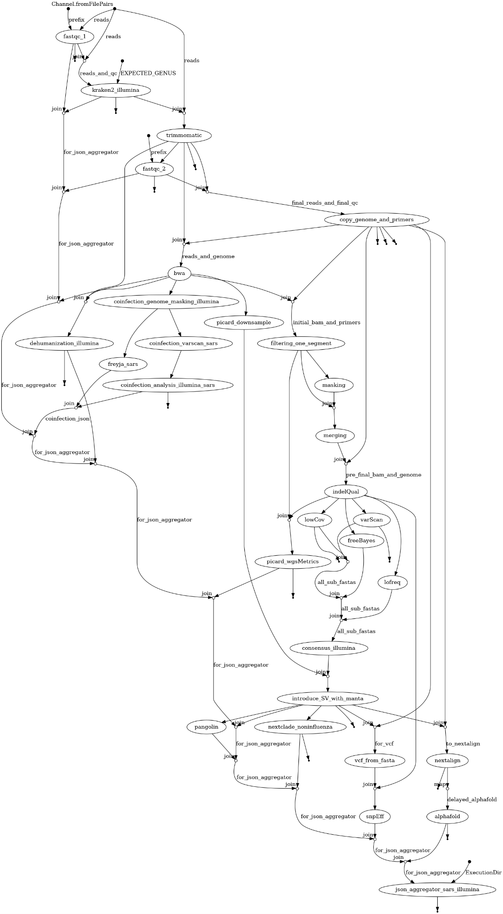

### Illumina Influenza Flowchart

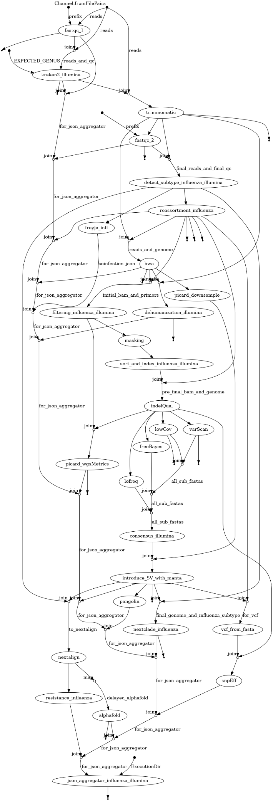

### Illumina RSV Flowchart

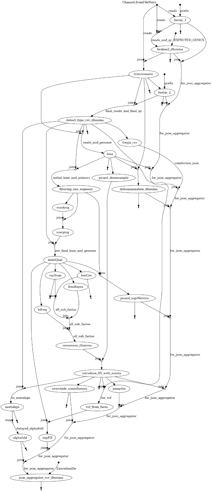

### Nanopore Sars-CoV-2 Flowchart

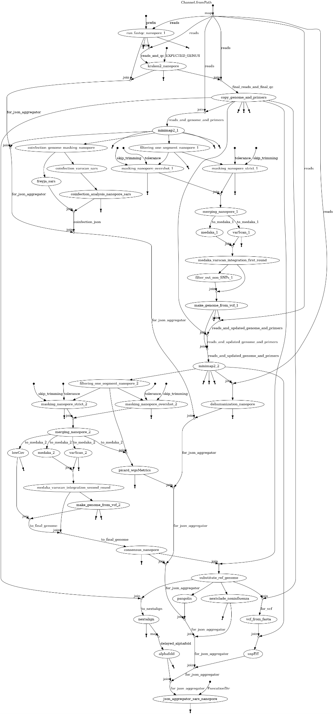

### Nanopore Influenza Flowchart

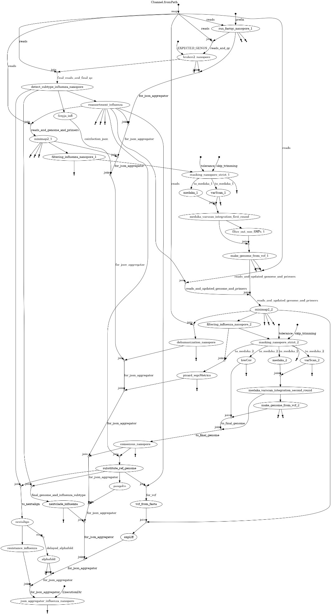

### Nanopore RSV Flowchart

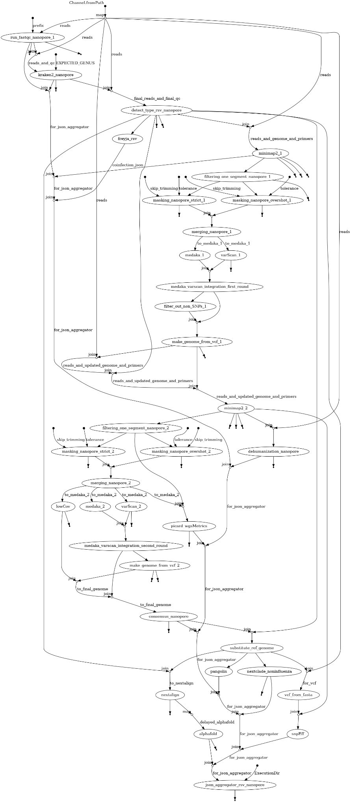

### Bacterial pipeline for Illumina

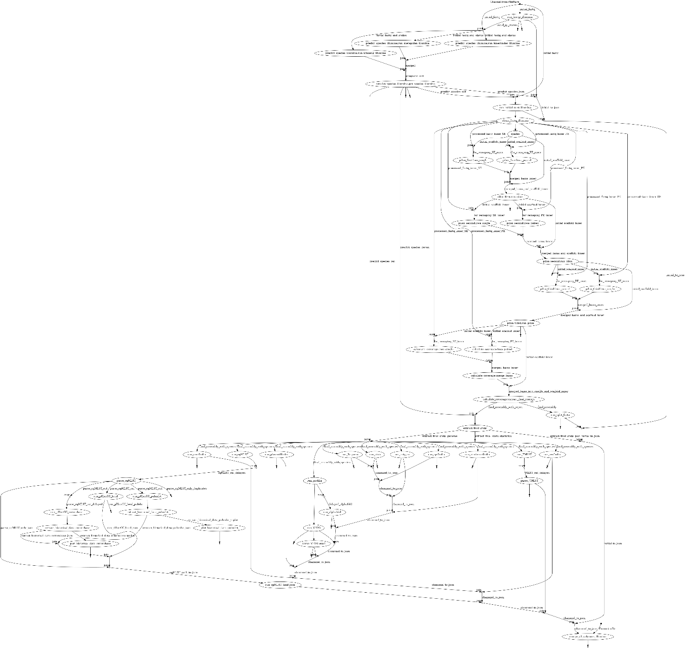

### Bacterial pipeline for Nanopore

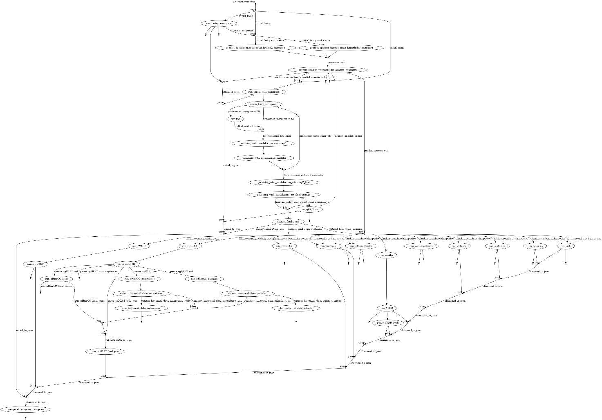

# 5. External and Internal data

This chapter summarizes all relevant information about external data. The data ca be divided into two categories:

1.  **External Data** External data refers to files or groups of files available to the pipeline but stored outside the Docker images build in section 2.2.1. This approach allows the data to be updated independently of the Docker image. However, users are responsible for downloading and organizing the data themselves. External data typically includes large datasets or information that changes regularly, making it impractical to embed within the Docker image. This type of data is generally not curated by the authors of this pipeline.

2.  **Internal Data** Internal data refers to files or groups of files stored within the Docker image. This eliminates the need for users to manage or organize the data, as it is prepackaged with the pipeline. However, updating internal data requires rebuilding the Docker image. Internal data is usually small, unlikely to change in the near future. In some case internal data are defined as such as they should be curated by the pipeline's authors to ensure the pipelines produces valid results.

## 5.1. Downloading the Data

1.  **External Data** To download external data, follow the instructions provided in Section 2.2.5.

2.  **Internal Data** Internal data is pre-package and included in the main repository. They are available to the pipeline once the docker images are successfully created.

## 5.2. Updating the data

1.  **External Data** There is no single procedure for updating all databases in external data, as individual components originate from different sources. Some databases can be updated incrementally, appending new data to the existing files. This include e.g. the Enterobase database used by the bacterial pipeline. For other databases, it is usually more efficient to simply delete the old files and download the complete dataset again. In essence executing the same command as in 2.2.5 will perform “updating” task.

In Section 5.4, we provide a brief description of each external and internal dataset, including its origin, update procedures, and the frequency of updates performed locally at NIH Poland.

2.  **Internal data.** Updating internal data requires rebuilding the main Docker image used by the program. Before proceeding, it is recommended to check if an update is actually necessary:

Check the Current Commit of Your Local Repository

```bash
cd plepiseq-wgs-pipeline
git rev-parse HEAD
```

Compare the commit identifier with the Latest commit available on github https://github.com/BioinfoPZH/plepiseq-wgs-pipeline. If your local repository is outdated update it by typing

```bash
git pull
```

Remove the old images, and rebuild them, this procedure is identical to performing “clean” installation as provided in Section 2.2.1

```bash
docker image rm plepiseq-wgs-pipeline-viral:latest
docker build --target main -f docker/Dockerfile-viral -t plepiseq-wgs-pipeline-viral:latest .
```

Updating other Docker images created in Section 2.2.1 is typically unnecessary, as they do not include internal data.

3.  Automated regular updates. If slurm is installed you can use scrontab to regularly execute databases update (e.g. once a week). To do so:

1.  Prepare a simple shell script with instructions. Below is an example of such script used in PZH. In this script we (I) enter the directory with repository (**adjust path**) and (II) execute update_external_databases.sh with some specific options. Place the script in directory of your choosing e.g. /home/USER/plepiseq_updates

```bash
#!/bin/bash
cd /home/michall/git/plepiseq-wgs-pipeline
./update_external_databases.sh --database all \
--output /mnt/raid/external_databases \
--cpus 50
```

2.  Type scrontab and modify the file by adding specific entry. (see example below). Lines starting with \#SCRON have a similar function to \#SBATCH lines for script executed via sbatch command. Remember to adjust name of node and queue, number of cpus etc.

```text
#SCRON --job-name=databases_update
#SCRON --partition=db_updates
#SCRON --nodes=1
#SCRON --nodelist=a100-1
#SCRON --ntasks-per-node=1
#SCRON --cpus-per-task=255
#SCRON --time=0-03:00:01
#SCRON --mem=750G
#SCRON -o /home/michall/test/slurm_logs/database_update.log
#SCRON -e /home/michall/test/slurm_logs/database_update_error.log
00 14 * * 6 /home/michall/plepiseq_updates/update_all_databases.sh
```

With this entry we:

1.  Define jobs’ name (“database_update”)

2.  Define partition for the resources allocation. In PZH “db_updates” has the highest priority, and any other slurm job won’t execute, if overlapping with “database_update” job

3.  Define where the job will be executed (a node name a100-1)

4.  Define duration of the job and amount of resources allocated

5.  Finaly “00 14 \* \* 6” provides information when the job is executed (see https://crontab.guru/) . In this case “every Saturday at 14:00”

We can never guarantee that a given database is accessible at the moment when update is carried out.. Thus it is a good practice to backup database prior to update as some file might be simply deleted.

## 5.3. Database structure

1.  **External data** should be organized in a specific way as shown in a figure below.

This organization is established when all the data is downloaded as described in section 2.2.4.1. The subdirectories of each database are explained in a greater details below.

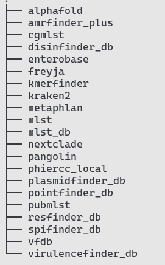

Changing this organization in any way will most likely lead to failure in our pipeline

2.  **Internal data** in a repository are kept in the **data** directory and are organized as shown in a figure below.

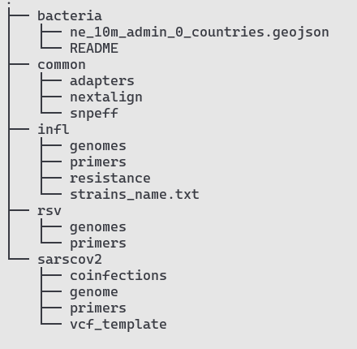

## 5.4. External Datasets utilized by the program

### Nextclade

1.  **Brief description.** Nextclade ([link](https://docs.nextstrain.org/projects/nextclade/)) is software used to classify samples into clades based on phylogenetic analysis of both currently and historically circulating strains of a given pathogen. The topology of the phylogenetic tree, as well as clade assignment and naming, is maintained by the Nextclade consortium.

2.  **Usage in the Pipeline.** This dataset is used for all organisms and sequencing platforms. The Nextclade assignment for SARS-CoV-2 and RSV viruses is based on the whole genome sequence of these pathogens. For Influenza classification, it can be based on the sequence of either the HA or NA segments. However, Influenza samples classification is available only for the samples of following subtypes: A/H1N1, A/H3N2, B/Victoria, and B/Yamagata (only the HA segment).

3.  **Database organization** Once downloaded, the nextclade directory within the external_databases folder should be organized as follows:

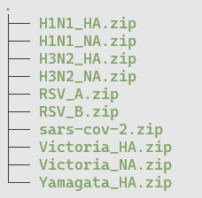

4.  **Updating Data:** There is no specific updating procedure for this data. To download the latest version of the Nextclade database, **all files are removed** from the nextclade directory and new files are downloaded. To update only this database type:

```bash
./update_external_databases.sh --database nextclade --output /path/to/external_databases/
```

5.  **Additional comments.** A detailed manual regarding the datasets used by Nextclade is available at [Nextclade Datasets Documentation](https://docs.nextstrain.org/projects/nextclade/en/stable/user/datasets.html). To download specific data, the Nextclade authors provide a useful wrapper. For example, to download data required to classify an A/H1N1 sample using the HA segment sequence, use the following command:

```bash
nextclade dataset get --name='flu_h1n1pdm_ha' --output-zip H1N1_HA.zip
```

This type of command is also used by the update_external_databases.sh script. The downloaded ZIP file can be directly used by the Nextclade program. Under the hood, Nextclade downloads the index.json file from <https://data.clades.nextstrain.org/v3/index.json>, and based on that file, it determines what to download and from where.

### Pangolin

1.  **Brief description.** PANGOLIN (Phylogenetic Assignment of Named Global Outbreak LINeages) is an alternative to Nextclade for assigning evolutionary lineages to SARS-CoV-2 sequences. It utilizes the UShER program to determine the most likely placement of a query sequence on a pre-calculated phylogenetic tree. This tree and other necessary files are part of the pangolin_data dataset, located in the data directory of the Pangolin repository:<https://github.com/cov-lineages/pangolin/tree/master/pangolin/data>.

2.  **Usage in the Pipeline** The Pangolin lineage assignment is exclusively used in workflows involving SARS-CoV-2 data.

3.  **Database organization** Once downloaded, the pangolin directory within the external_databases folder should follow this structure:

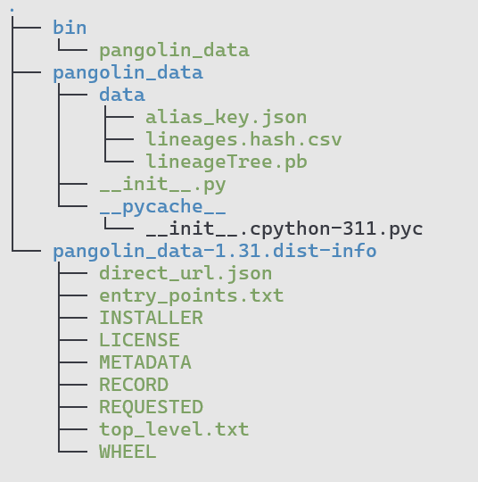

4.  **Updating Data**. Updating and downloading the pangolin_data dataset can be done in multiple ways. For instance, it can be updated using pip:

```bash
pip install --target . --upgrade git+https://github.com/cov-lineages/pangolin-data.git
```

However, for consistency we recommend using the update_external_databases.sh script. Run the following command:

```bash
./update_external_databases.sh --database pangolin --output /path/to/external_databases/
```

The Pangolin, like Nextclade dataset, is relatively small, hence update procedure is in fact removal of old files and downloading everything from remote directory from scratch.

5.  **Additional comments** The pangolin_data dataset is in fact a Python package imported when the Pangolin program is executed (refer to line 7 of the pangolin/command.py script in the pangolin repository). In principle, downloading all files from the [Pangolin Data Repository](https://github.com/cov-lineages/pangolin/tree/master/pangolin/data) to any local directory and updating the PYTHONPATH environment variable is sufficient to successfully run the program with downloaded data.

### Kraken2

1.  **Brief description.** [Kraken 2](https://ccb.jhu.edu/software/kraken2/) is a taxonomic classification system that utilizes exact k-mer matches for assigning sequencing reads to specific taxa. In the pipeline, Kraken 2 is used to classify reads at the genus level and detect potential contamination from unexpected genera. The program relies on a pre-built database whose size varies based on the number of taxa included: The standard database (as of 2025) is approximately 80 GiB. Smaller databases (16 GiB or 8 GiB) are available, though at the cost of reduced sensitivity and accuracy. Including protozoa increases the database size to over 180 GiB.

**Important Note:** Kraken2 loads the entire database into RAM during execution. Insufficient memory to accommodate the database will cause the analysis to fail.

2.  **Usage in the Pipeline**. The Kraken 2 database is used across all workflows in the pipeline.

3.  **Database organization** After downloading (refer to Section 2.2.4.1), the kraken2 directory in the external_databases folder should have the following structure. By default, the standard database is downloaded.

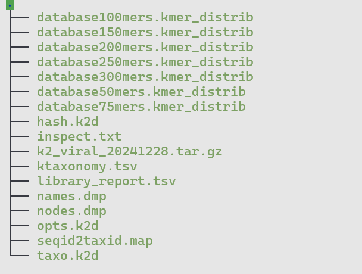

4.  **Updating Data.** To update Kraken 2, an additional argument (--kraken-type) specifies which database to download, “standard” is used when this parameter is not set. The list of available databases can be found [here](https://benlangmead.github.io/aws-indexes/k2).

```bash
./update_external_databases.sh --database kraken2 --output /path/to/external_databases/
```

The update mechanism works by comparing the MD5 checksum of the locally stored database (.tar.gz file) with the checksum of the database available on AWS. An update occurs only if the checksums differ, preventing unnecessary downloads of large files.

5.  **Additional comments**

A complete list of pre-built Kraken2 databases is available at <https://benlangmead.github.io/aws-indexes/k2> and <https://github.com/BenLangmead/aws-indexes>. For users who wish to create custom databases with their own sequences, a detailed tutorial is available in the [Kraken2 manual](https://github.com/DerrickWood/kraken2/wiki/Manual#kraken-2-databases).

Downloading pre-built databases from AWS can be done using awscli (available via apt), the boto3 Python library (available via pip), direct HTTP protocol

When updating kraken2 database toy can provide additional option to the update_external_databases.sh script ( --kraken-type) if you wish to download specific kraken2 prebuild database. If you do not provide this option “standard” database is downloaded

There are several pre-defined databases used by the Kraken2 program. To specify which version you wish to download use --kraken-type \[version\]. Available versions: “standard" "standard_08gb" "standard_16gb" "viral" "minusb" "pluspf" "pluspf_08gb" "pluspf_16gb" "pluspfp" "pluspfp_08gb" "pluspfp_16gb" "nt" "eupathdb48". By default program will download “standard” database.

### Freyja

1.  **Brief description.** Freyja (<https://andersen-lab.github.io/Freyja/index.html>) is a tool designed to recover relative lineage abundances from sequencing datasets. It operates by leveraging a mathematical model based on mutation profiles:

- vector **V** of size *m* represents the abundance of reads with specific major alleles at predefined positions.

- The database is essentially a matrix **M** of size *n×m*, where rows correspond to specific lineages and columns capture mutation presence at specific positions. For instance, if M\[1,2\]=1, it may indicate that the lineage at index 1 (e.g., JN.1) contains a mutation at position 298 (column 2).

Using this model, Freyja solves the equation **V**×**k**=**M**, where **k** is a vector of size *n* representing the relative abundance of all lineages in the sample.

2.  **Usage in the Pipeline** Freyja is utilized across workflows for all viruses. However, similar to Nextclade, its data for Influna virus is limited to specific subtypes, including: A/H1N1 A/H3N2 A/H5Nx B/Victoria.

3.  **Database organization** After downloading all the databases (refer to Section 2.2.5), the freyja directory in the external_databases folder should have the following structure.

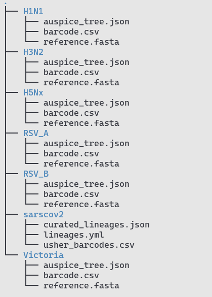

4.  **Updating Data** The Freyja database is relatively small, and updates are straightforward. To update the database**,** execute the update_external_datasets script

```bash
./update_external_databases.sh --database freyja --output /path/to/external_databases/
```

At NIH Poland, this database is updated weekly.

Like all the other databases we recommend to put this code to crone job

5.  **Additional comments** Freyja datasets consist of flat files downloaded from two repositories: For SARS-CoV-2 we use <https://raw.githubusercontent.com/andersen-lab/Freyja-data/>, while for all the other organisms files are downloaded from <https://raw.githubusercontent.com/andersen-lab/Freyja-barcodes>.

### Alphafold

1.  **Brief description.** This database is required to run AlphaFold v2, an AI model used to predict 3D structures of proteins. For details, consult the official repository at <https://github.com/google-deepmind/alphafold>. Since version 1.2.0, the AlphaFold prediction step can be omitted and the resulting JSON output will include the following message: "Pipeline was executed with no-alphafold flag. No results are created.

2.  **Usage in the Pipeline.** AlphaFold is used by both viral and bacterial pipelines to predict structures of pre-selected proteins. Which proteins are modelled cannot be modified at the shell-wrapper level and requires changes to specific modules of the program. Viral modules that require this program include alphafold_slurm.nf and alphafold.nf (both in the modules/common/ directory). In the bacterial pipeline, AlphaFold is called via the run_alphafold and run_alphafold_slurm processes declared in nf_pipeline_bacterial.nf. The 3D structures of the following proteins are currently predicted: gyrase complex (subunits A and B) for bacterial species, haemagglutinin and neuraminidase for influenza, Spike for SARS-CoV-2, and F and G proteins for RSV.

3.  **Database organization.** After successful execution of steps 2.2.2 and 2.2.5, the alphafold directory in the external_databases folder should have the following structure.

    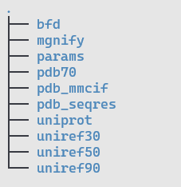

Be advised that AlphaFold by default downloads nearly 3 TB of data. In practice, as our pipeline is used to model 3D structures of a small set of well-known proteins, data stored in most sequence databases (such as bfd) can be omitted. As a result, only the following directories are strictly required to run the program: uniref50/, pdb_mmcif/, pdb_seqres/, uniprot/, pdb70/, and params/ (which holds the weights for the AlphaFold2 program).

4.  **Updating Data.** For the same reason as explained above, only the uniref50 and uniprot sequence databases are updated by the update_external_databases.sh script. At NIH Poland, these databases are updated weekly.

5.  **Additional comments**

### Amrfinder_plus

### Cgmlst

### Disfinder_db

### Enterobase

### Kmerfinder

### Metaphlan

### Mlst

### Mlst_db

### Phiercc_local

### Plasmidfinder_db

### Pointfinder_db

### Pubmlst

### Resfinder_db

### Spifinder_db

### Vfdb

### Virulencefinder_db

## 5.5. Internal Datasets utilized by the program

### Adapters data

1.  **Location:** data/common/adapters

2.  **Brief description.** When the length of an insert (the DNA fragment intended for sequencing) is shorter than the total number of sequencing cycles, residual adapter sequences may remain on the 3’ or 5’ ends of the reads. These unnecessary sequences should be removed, which requires specifying the adapter sequences used during the sequencing process.

3.  **Usage in the Pipeline** Adapter sequences are used to trim unwanted nucleotides from reads obtained with Illumina-based sequencing. Consequently, this data is utilized in all workflows involving sequencing with Illumina platforms.

4.  **Database organization**

Adapter sequence are stored in data/common/adapters directory, its structure should be as follow:

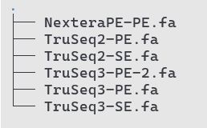

5.  **Additional comments** All adapter sequences were downloaded from the Trimmomatic repository (<https://github.com/usadellab/Trimmomatic/tree/main/adapters>.). Which specific sequences is to be trimmed is determined by one of the pipeline parameters.

### Nextalign data

1.  **Location:** data/common/nextalign

2.  **Brief description.** This dataset is used to predict the amino acid sequences of all proteins encoded in the genomes of SARS-CoV-2, Influenza, and RSV viruses. Predictions are made using the Nextalign program, which was previously part of the Nextclade program but is now discontinued.

3.  **Usage in the Pipeline.** The data is used in all workflows, it is used by the “nextalign” module.

**Database organization** Data for the Nextalign function is stored in the data/common/nextalign directory, which should follow this structure:

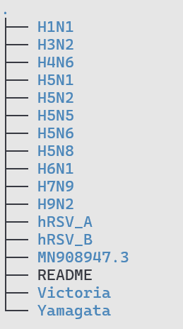

Each directory contains organism-specific data (for SARS-CoV-2), subtype-specific data (for Influenza virus) or type-specific data (for RSV). Each subdirectories include:

- **GFF files**: Indicate the location of CDSs (coding sequences) in the reference genome (1-indexed, left including).

- **FASTA files**: Contain the genomic sequences. For Influenza, a separate FASTA file should be present for each segment.

Below an example of data for H1N1 subtype.

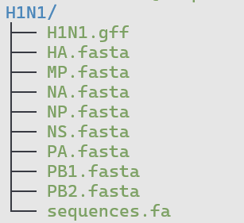

4.  **Additional comments** All data was manually prepared by predicting CDSs from “reference” genomic sequences selected by the authors. The genomic sequences in these directories may **not always align** with the reference sequence used for mapping procedures and for snpEff program

The Nextalign program works by aligning the CDSs (extracted from the reference genome FASTA file using the GFF file) to the genomic sequence proposed for a sample. Once the CDSs of a sample are identified, translating them into amino acid sequences is straightforward. Hence, there is no need for reference sequence to be identical to one used for mapping, and, likewise, there is no need to keep separate references for various clades of a given subtype.

### snpEff data

1.  **Location:** data/common/snpeff

2.  **Brief description.** This dataset includes files required by the snpEff program, which predicts the effects of mutations observed in a sample’s genome relative to a predefined reference genome. If a mutation falls within a CDS region, the program reports its impact on the amino acid sequence of the corresponding protein. For more information on snpEff, visit https://pcingola.github.io/SnpEff/.

3.  **Usage in the Pipeline** The snpEff database is utilized in the **snpEff** module, which is included in all viral workflows.

4.  **Database organization**


The data/common/snpEff directory contains the following:

1.  **snpEff.config** – This configuration file, which is part of the snpEff program, has been modified to include information about hRSV and Influenza viruses, which are not included in the original configuration. Our modifications involve appending 10 additional lines at the end of the file, specifying where the program should locate the data for these viruses.

2.  **Data**/. This directory contains the actual data required by snpEff for each virus, type (for RSV), and subtype (for Influenza), stored in subdirectories. Additionally, it includes an intentionally empty directory named hybrid. For Influenza-related data, each subtype subdirectory contains two files:

- **sequences.fa** A FASTA file with reference sequences for the given subtype. Each segment has a separate entry, with names consistent with pipeline conventions (e.g., chr1_PB2, chr2_PB1, etc.).

- **genes.gtf,** A GTF file containing location of genes, transcripts, and CDSs in sequences.fa. The GTF format, like GFF, is 1-indexed and right-open.

Both files are required to produce a valid database for snpeFF. This is done internally by the pipeline in the snpEff module.

For SARS-CoV-2 and RSV, their respective subdirectories contain at least:

- **sequences.fa** A FASTA file with reference sequence

- **snpEffectPredictor.bin** The precomputed snpEff database file for the reference genome. Unlike Influenza subtypes, these databases are not built “ad hoc” in the snpEff module, but are used “as in”

5.  **Additional comments**

- Reference sequences used for snpEff are identical to those used for mapping reads. Consult section regarding reference genomes of individual viruses for details.

### Influnza-specifi data

1.  **Location:** data/infl

2.  **Brief description.** The data located in the /data/infl directory is dedicated exclusively to influenza-specific analyses.

3.  **Usage in the Pipeline** This data is utilized solely by workflows related to influenza.

4.  **Database organization**

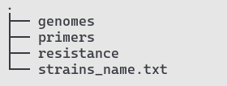

Data in split into 3 directories:

1.  **genomes/**

- Subdirectories are named according to the influenza subtype they correspond to (e.g., H1N1, H3N2). For certain subtypes, there are additional directories for specific clades (e.g., H1N1_6b1a5a2 for lineage 6b1a5a2 and H1N1_6b1a5a2a1 for lineage 6b1a5a2a1).

- Each subdirectory contains a reference genome in FASTA format, named identically to the subdirectory, with the .fasta extension (e.g., H1N1.fasta).

- FASTA files are indexed with the bwa program, so additional index files are present.

- Occasionally, a README file is included, written in Polish, explaining the origin of the sequence and any modifications made to produce the final sequence.

2.  **primers/**

- This directory follows a similar structure to genomes/, with subdirectories corresponding to the subtypes.

- Each subdirectory contains a BED file with the locations of universal primers that match sequences in the corresponding subdirectory in the genomes/ directory.

- Unlike SARS-CoV-2, influenza does not have multiple versions of primers for a given organism.

3.  **resistance/**

This directory contains information necessary to predict the susceptibility of influenza samples originating from predefined subtypes to antiviral drugs. Data is based on the WHO-provided PDFs available at:

- <https://www.who.int/publications/m/item/summary-of-neuraminidase-(na)-amino-acid-substitutions-associated-with-reduced-inhibition-by-neuraminidase-inhibitors-(nais)>

- <https://www.who.int/publications/m/item/summary-of-polymerase-acidic-(pa)-protein-amino-acid-substitutions-analysed-for-their-effects-on-baloxavir-susceptibility>.

For each subtype, the directory includes:

- Two FASTA files containing the amino acid sequences of two proteins (NA and PA) for WHO-designated reference strains.

- Two text files: NA_resistance.txt and PA_resistance.txt, which include data from the above PDFs in text format.

- N2_numbering.txt, that provides mapping between numbering of amino acids in NA from the reference strain of a given subtype, and the NA numbering of the NA subtype 2 reference strain.

Additionally, the file “strains_name.txt “ provides details about the reference strains used for each subtype (and clade, if applicable) e.g. Strain name and GISAID ID. Information for each segment is provided in columns.

5.  **Additional comments**

The inclusion of references for currently circulating clades of rapidly evolving subtypes addresses poor mapping performance when sequencing data are aligned to a single, reference genome. For example, mapping all reads to the H3N2 reference strain A/Perth/16/2009 often yields suboptimal results.

Changes made to sequences obtained from GISAID to produce those stored in this directory are not explicitly documented. However, users can compare the original sequences with the ones in this repository by performing an alignment. Most changes involved addition of primer sequence at 3’ and 5’ end of the segment, sequences that are often not reported in GISAID. In most extreme cases, only CDS is reported for a given subtype. In such cases we added missing fragments using other GISAID entry, preferably originating from sequencing of the same strain as selected originally.

### Internal/rsv

1.  **Location:** data/infl

2.  **Brief description.** The data located in the /data/rsv directory is exclusively dedicated to RSV-specific analyses.

3.  **Usage in the Pipeline** This data is utilized solely by workflows related to RSV.

4.  **Database organization**


The structure of the /data/rsv directory is similar to that of the Influenza virus directory but with RSV-specific distinctions, as for RSV we distinguish two types of this virus “A” and “B”.

1.  **genomes/** is divided into three separate subdirectory – RSV, RSV_A, and RSV_B.

- For RSV A the reference sequence is identical to the reference sequence selected by the Nextclade consortium https://github.com/nextstrain/nextclade_data/tree/v2/data/datasets/rsv_a/references/EPI_ISL_412866.

- For RSV B the reference sequence was obtained from the ARTIC repositor (<https://github.com/artic-network/artic-rsv/tree/main/resources/RSVB/V1>).

- The RSV directory includes a FASTA file containing combined genome data from both RSV types (A and B). All genome FASTA files are indexed using the bwa program.

2.  **primers/** The primers directory is further divided into two subdirectories: “A” and “B”. Each contains two subdirectories “V0” and “V1”.

- V0 is an informal name for primers proposed in the article "Sequencing and analysis of globally obtained human respiratory syncytial virus A and B genomes." These primers consist of 4 pairs of primers

- V1/: Primers designed by the ARTIC consortium, available on [GitHub](https://github.com/artic-network/artic-rsv/tree/main/resources) <https://github.com/artic-network/artic-rsv/tree/main/resource>. These primers follow the same design logic as those proposed for SARS-CoV-2, consisting of 50 pairs of primers separated into two pools.

“V0” and “V1” are the only valid primer sets if RSV is specified as value for the **species** parameter in the pipeline.

5.  **Additional comments** None

### Internal/sarscov2

1.  **Location:** data/sarscov2

2.  **Brief description.** The data located in the /data/rsv directory is exclusively dedicated to RSV-specific analyses.

3.  **Usage in the Pipeline** This data is utilized solely by workflows related to SARS-CoV-2.

4.  **Database organization**

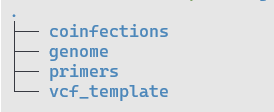

The structure of the /data/sarscov2 is divided into four main subdirectories. Unlike the directories for Influenza and RSV, there is no further subdivision by virus types or subtypes.

1.  **genomes/** contain a reference genome of SRAS-CoV-2 used for mapping. It was downloaded from the NCBI webpage (<https://www.ncbi.nlm.nih.gov/nuccore/MN908947.3>) and corresponds to the original Wuhan-1 strain. The genome is indexed with the bwa program.

2.  **primers/** includes data regarding primers used to amplify SARS-CoV-2 genetic material. There are several “versions” of primers available to achieve this task, each with specific subdirectory . Currently following set of primers are implemented:

- V1 to V.5.3.2 -version of primers designed by the ARTIC consortium available on github:

<https://github.com/epi2me-labs/wf-artic/tree/master/data/primer_schemes/SARS-CoV-2/ARTIC>

- V1200 – the “Midnight” set of primers used mostly for amplification prior to sequencing with Nanopore device, based on the data from:

https://zenodo.org/record/3897530#.Xv5EFpMzadY

- EQA2023.\* and EQA2024.\* - primers used in European Quality Assessment (EQA) for the SARS-SoV-2 virus.

- VarSkip\* - a set of four primers schemes used by the New England Biolabs (NEB) available at <https://github.com/nebiolabs/VarSkip>.

All primers in this directory have been "artificially" extended to make amplicons 1 bp longer at both the 5' and 3' ends. This modification ensures that the ivar program properly masks reads mapping just 1 bp beyond the amplicon, which, although biologically unsound, often appear in sequencing data. Further details on the structure of .bed and pairs.txt files in these subdirectories are provided in **Appendix B.**

Names of directories are at the same time valid values for “primers” option of the pipeline

3.  **coinfections/** directory includes results that in the EQA test represent data for samples identified as “coinfected” with two lineages of the SARS-CoV-2 virus. All .txt files in this directory were obtained after analysis of the above-mentioned samples with the VarScan program. The sampes which name includes “SARS1“ were obtained by sequencing with the ONT technology, while samples with “SARS2” name were obtained with Illumina. During pipeline processing, these files are compared with the results from newly analyzed samples. If sufficient similarity is identified, the sample is flagged as “coinfected.” Consult the “coinfections_analysis” module for more detailed explanation.

4.  **vcf_template/** Contains a template of an empty VCF file along with its index. This file is required by a "Reader" function in the VCF Python package, used in one of the pipeline modules.

<!-- -->

5.  **Additional comments** None

# 6. Running pipeline

In this chapter we explain in details how to run the pipeline and how modification, the avaialbe options and values they can assume. In principal, the pipeline can be executed to the same effect using nextflow program and the provided shell wrapper, however, we recommed the latter option. The main benefit of thiis approach is that we plan to keep recommended in shall wrapper, and remove them in near future from the .nf file. Secondly, validation of user provided values is carried out only when using the wrapper. Finally, the wrapper allows to acces to both viral and bacterial pipeline.

## 6.1. Running the viral pipeline

### Nextflow execution

To execute the pipeline directly with Nextflow, you must provide all required pipeline parameters. The combination of values passed to the --machine and --species options determines which workflow is executed with the user-provided parameters. The command below is a starting point for running the pipeline if you choose not to use the recommended shell wrapper.

```bash
nextflow run /path/to/ /repository/nf_pipeline_viral.nf --reads="path+pattern" \
--machine="string" \
--species="string""\
--primers_id="string"\
--main_image="string"\
--manta_image="string" \
--medaka_image="string" \
--alphafold_image="string"\
--projectDir="path" \
--external_databases_path=path" \
--mask=20 \
--quality_snp=15 \
--etc
```

Since version 1.4.0, default parameters are stored **only** in the corresponding shell wrappers. When running the pipeline directly with nextflow run, the user must specify all options manually. Be advised that Nextflow does not validate the semantics of the provided parameters; incorrect values may cause the pipeline to fail or produce unexpected results .

### Execution with shell wrapper

Using the shell wrapper is the recommended way to run the pipeline. Starting from version 1.4.0, all default parameters are defined only in the shell wrapper. Consult Section 2.3 for a minimal example of shell-wrapper execution for viral species.

### Pipeline’s options

There are two main types of parameters *obligatory* and *optional*. Obligatory parameters have (usually) no default values and must be provided by the user when starting the pipeline. We tried to minimize the number of explicit options and restrict them to paths to input files and information about the sequencing process and preparation of biological material. Additionally, “semi-obligatory” parameters specify the locations of databases and names of Docker images used by the pipeline. If the user followed the installation instructions from Section 2.2, these values can be undeclared. Optional parameters have default values that, in our opinion, allow the user to obtain biologically meaningful output in typical use cases.

### Obligatory arguments

--reads – Path pattern to reads in fastq.gz format. For paired-end Illumina sequencing, the pattern must allow the pipeline to distinguish a pair of reads. For example, if paired files in a directory are named sample1_R1.fastq.gz and sample1_R2.fastq.gz, the pattern should be \*\_R{1,2}.fastq.gz. If the reads are named sample1_1.fastq.gz and sample1_2.fastq.gz, the pattern should be \*\_{1,2}.fastq.gz. For single-end sequencing with Nanopore, all reads for a sample must be stored in a single file and the pattern can simply be \*.fastq.gz. If a directory contains output for multiple samples, the pipeline will analyze data for all of them, as long as the reads from different samples follow the same naming scheme (e.g. sample1_R1.fastq.gz, sample1_R2.fastq.gz, sample2_R1.fastq.gz, sample2_R2.fastq.gz, ...) To read more consult nexflow documentation for paired-end:

<https://www.nextflow.io/docs/latest/reference/channel.html#fromfilepairs>

and for single end reads:

<https://www.nextflow.io/docs/latest/reference/channel.html#frompath>

--species - Name of the virus that underwent sequencing. Allowed values: SARS-CoV-2, Influenza, RSV.

--machine - Sequencing platform. Allowed values: Nanopore, Illumina.

--primers_id - Name of the amplicon scheme used to amplify genetic material. Allowed values:. EQA2023.SARS1, EQA2023.SARS2, EQA2024.V4_1, EQA2024.V5_3, V1, V1200, V3, V4, V4.1, V5.3.2, VarSkip2 VarSkip2b VarSkip1a VarSkip_long_1a (for SARS-CoV-2); V0, V1 (for RSV). For Influenza, this parameter is ignored.

--projectDir Directory with the project repository.

--external_databases_path - Directory with all databases used by the program. Default: "/mnt/raid/external_databases"

--main_image - Name of the Docker image with the main program. Default: plepiseq-wgs-pipeline-viral:latest

--manta_image - Name of the Docker image with the Manta program. Default: plepiseq-wgs-pipeline-manta:latest

--medaka_image - Name of the Docker image with the Medaka program. Default: ontresearch/medaka:sha447c70a639b8bcf17dc49b51e74dfcde6474837b-amd64)

--alphafold_image - Name of the Docker image with the AlphaFold program. Default: alphafold2:latest)

### Optional arguments

--adapters - Adapters used during Illumina-based sequencing. Default: TruSeq3-PE-2, as we expect that most users will use TruSeq3 adapters. The list of available adapters is: NexteraPE-PE, TruSeq2-PE, TruSeq2-SE, TruSeq3-PE-2, TruSeq3-PE, TruSeq3-SE. FASTA files with adapter sequences are located in /data/common/adapters.

--max_number_for_SV - Maximum number of reads used to predict structural variants (SVs) with Manta. Default value depends on species – 200_000 for SARS-CoV-2, 100_000 for RSV and 10_000 for Influenza

--min_median_for_SV - Minimum median coverage for a segment required for SVs calling with Manta. Deafult: 50

--variant - Name of the expected influenza subtype (e.g. H5N1). To auto-detect subtype this options should be se to “UNK”. Default value “UNK”. This parameter is only valid for Influenza

--min_number_of_reads Minimum number of reads in a FASTQ file required for the program to execute. Default is 1.

--expected_genus_value - Minimal percentage of reads associated with the expected species for the program to execute. Default value: 5%

--min_median_quality - Minimum median base quality in a read for it to be included in the analysis with the FastQC-based module. Default 0 (all basses are included in the analysis)

--quality_initial - Minimum quality of bases at the 5' and 3' ends of reads not trimmed with Trimmomatic. Defaults: 5 for Illumina, 2 for Nanopore..

--length - Minimal length of a read after quality trimming for it to be used in the analysis. Default: 90 for Illumina, 49% of the initial read length for Nanopore.

--max_depth - Maximum expected coverage at each position after coverage equalization procedure. Default: 600.

--min_cov - Minimum coverage at a position required to identify SNPs/INDELs. Defaults: 20 for Illumina, 50 for Nanopore.

--mask - Maximum coverage value below which regions are masked with 'N' due to low coverage. Defaults: 20 for Illumina, 50 for Nanopore.

--quality_snp - Minimum nucleotide quality in a read to be considered during SNP/INDEL/SV calling. Defaults: 15 for Illumina, 5 for Nanopore.

--pval - p-value threshold to determine if a variant is significant for Illumina data. Default: 0.05. Only valid for Illumina. Two equivalent parameters for Nanopore data are first_round_pval and second_round_pval

--lower_ambig - Minimum ratio of reads carrying a minor allele at a given position above which ambiguous symbol can be introduced . Default: 0.45.

--upper_ambig - Maximum ratio of reads carrying a minor allele at a given position below which ambiguous symbol can be introduced. Default: 0.55

--window_size - Window size used during coverage equalization. Default: 50.

--min_mapq - Minimum mapping quality of a read to a reference genome to be used by the program. Default: 30.

--quality_for_coverage - Minimum nucleotide quality considered during determination of low coverage regions. Defaults: 10 for Illumina, 1 for Nanopore.

--freyja_minq - Minimum mapping quality of a read to a reference genome for coinfection analysis with Freyja. Defaults: 20 for Illumina, 2 for Nanopore.

--bed_offset - Number of bases by which a read can exceed the primer boundary. Nanopore-specific; default: 10.

--extra_bed_offset - Number of bases by which a low-quality read can additionally exceed the primer boundary. Nanopore-specific; default: 10.

--medaka_model - Medaka model. Nanopore specific parameter. Default: 941_min_sup_variant_g507".

--medaka_chunk_len - Medaka chunk length. Nanopore specific parameter. Default: 5_000 (for SARS-CoV_2 and RSV), 1_000 (for Influenza).

--medaka_chunk_overlap - Medaka chunk overlap. Nanopore specific parameter. Default: 4_000 (for SARS-CoV_2 and RSV), 500 (for Influenza).

--first_round_pval - p-value to determine if a variant is significant during initial genome prediction. Nanopore-specific parameter. Default: 0.25.

--second_round_pval - p-value to determine if a variant is significant during genome fine-tuning. Nanopore-specific parameter. Default: 0.05.

--results_dir - Directory to store results. Default ./results.

--threads - Maximum number of CPUs allocated to a single module within Nextflow. Default: 40.

--profile- Name of the profile specified in the Nextflow configuration file (Section 2.1.5).Allowed values: “local” and “slurm”. Default “local”

--no-alphafold – Flag; provide this argument to skip AlphaFold calculations.

## 6.2. Running the bacterial pipeline

The bacterial pipeline reconstructs, annotates, and quality-controls bacterial genomes (currently Salmonella, Escherichia, and Campylobacter). As with the viral pipeline, the recommended way to run it is via the dedicated shell wrapper, which encapsulates all default parameters and calls the underlying Nextflow workflow. Consult Section 2.4 for a minimal example of shell-wrapper execution for bacterial species.

### Pipeline’s options

Like viral counterpart there are two types of parameters accepted by shell wrapper. Obligatory that do not have defined default values (save names of Docker images that follow naming pattern established in Chapter 2: Quick Start). Optional parameters, on the other hand, have default values that, in our opinion, allow the user to obtain biologically meaningful output in typical use cases.

### Obligatory arguments

--reads - Path pattern to the sequencing data in fastq.gz format, including a naming pattern that allows the script to group files by sample. It is recommended to enclose this argument in single quotes. Example: '/some/directory/\*\_R{1,2}.fastq.gz' for paired-end Illumina data.

--machine - Sequencing platform used. Allowed values: Nanopore or Illumina.

--projectDir - Path to the directory containing the cloned repository (project source code).

--external_databases_path Path to the directory with all external databases required by the pipeline. Default: "/mnt/raid/external_databases"

--main_image - Name (including tag) of the Docker image with the main pipeline software stack. Default: plepiseq-wgs-pipeline-bacterial:latest.

--prokka_image - Name (including tag) of the Docker image with the Prokka annotation program. Default: staphb/prokka:latest.

--alphafold_image - Name (including tag) of the Docker image containing the AlphaFold program for 3D structure prediction. Default: plepiseq-wgs-pipeline-alphafold:latest.

### Optional arguments

All remaining parameters are optional and have defaults chosen to provide sensible quality control and biologically meaningful results for typical bacterial WGS data. In most routine use cases, these options do not need to be modified.

--genus - Genus of the bacterium that underwent sequencing. Accepted values: Salmonella, Escherichia, Campylobacter. If omitted, the pipeline attempts to detect the genus automatically based on read classification (Kraken2).

--results_dir - Output directory for pipeline results. Default: ./results.

--threads Maximum number of CPU cores that can be allocated to a single nextflow module. Default: 40.

--profile - Name of the Nextflow profile defined in the configuration file, controlling the executor and runtime settings. Allowed values: "local", "slurm".Default: "local".

--quality - Maximum base quality at the 5' and 3' ends to be trimmed off. Defaults: 6 for Illumina, 2 for Nanopore.

--min_number_of_reads - Minimal number of reads required for a sample to be analyzed.

Defaults: 50_000 paired reads for Illumina; 10_000 reads for Nanopore.

--min_median_quality - Minimal median base quality required for a sample to be analyzed.

Defaults: 10 for Illumina; 5 for Nanopore.

--main_genus_value Minimal percentage of reads classified by Kraken2 to the main genus in a sample. Default: 50 (%).

--kmerfinder_coverage Minimal theoretical coverage for the main species in a sample as estimated by KmerFinder. Default: 20.

--main_species_coverage- Minimal theoretical coverage during species identification. Default: 20.

--min_genome_length - Minimal length of the final assembly (as a fraction of expected genome length for the identified species) required for a sample to pass QC. Default: 0.75.

--unique_loci - Minimal number of unique loci in the initial MLST screen. Samples with fewer unique loci are likely contaminated and are not analyzed.Defaults: 5 for Illumina; 0 for Nanopore.

--contig_number - Maximum number of contigs allowed after coverage-based filtering. Samples with more contigs are not analyzed. Defaults: 1_000 for Illumina; 100 for Nanopore.

--N50 - Minimal N50 value (length of the shortest contig at 50% of the total assembly length) required for a sample to pass QC threshold. Default: 30_000.

--min_coverage_ratio- Minimal coverage for a contig to pass filtering step, expressed as a fraction of the average coverage in the sample.Default: 0.1.

--final_coverage - Minimal required coverage calculated for final assembly required to execute downstream analysis. Default: 20.

--min_coverage_value. Minimal absolute coverage for a single contig to pass filtering. Default: 20. **Note:** this option is currently marked as *NOT IMPLEMENTED* and changing it has no effect*. min_coverage_ratio* parameter is as of now the ONLY parameter determining if a contig is accepted or rejected.

--model_medaka - Medaka model used to polish the Flye-proposed assembly and call SNPs/SVs. Valid only for Nanopore data. Default: r941_min_hac_g507 (still recommended even for R10 flow cells).

--no-alphafold – Flag, Skip calculation of 3D protein models with AlphaFold.

--all- Display the full help message (list of all parameters) and exit.

# 7. Modules

## 7.1. Module alphafold.nf (viral)

| Field | Value |
| --- | --- |
| Platform | Illumina, Nanopore |
| Species (Illumina) | SARS<br>INFL<br>RSV |
| Species (Nanopore) | SARS<br>INFL<br>RSV |
| QC switch | NO |
| QC Criteria |  |
| JSON output | YES |
| JSON key | "structural_data": {} |
| CPU | As set by “thread” option but not more than 15 CPUs |
| Memory | N/A |
| GPU | 1 |

### Brief description.

This module runs the AlphaFold2 program (included in the plepiseq-wgs-pipeline-alphafold:latest image, as described in Section 2.2.2.2) to predict the 3D structure of predefined viral proteins:

- SARS-CoV-2 – Spike

- Influenza – Haemagglutinin (HA) and Neuraminidase (NA)

- RSV – Fusion glycoprotein (F) and G protein (G)

### Detailed Comments

1.  **Input , Output and Workflow Placement**

This module accepts a single input channel, created by the **nextalign** module (emit: named "to_modeller"). The channel consists of a list with three elements:

- **Sample ID**

- **A sublist** containing any number of FASTA files

- **QC status**

As one of the final modules in the workflow, its output is used only by the JSON aggregator module and is not required by any other analytical module. This module produces two outputs:

- "to_pubdir" – ensures PDB files are placed in the output directory

- "json" – connects to the JSON aggregator

2.  **Hardware Requirements and Resource Management**

This module is the only one in the pipeline requiring a GPU. Since Nextflow does not natively manage GPU usage, we implement the following safeguards to prevent system overload on an 8-GPU server:

- **Limited Concurrency:** maxForks is set to 8. This must be adjusted if running the pipeline on a system with a different number of GPUs.

- **Automatic Retry on Failure:** The errorStrategy directive is set to "retry", and maxRetries is set to 3. If two instances of the module run on the same GPU, AlphaFold2 crashes, terminating the module with an error. The pipeline will attempt to rerun the module for this input data up to three times, adhering to the maxForks rule. Only if module with the same input fails three times, the entire workflow will terminate with an error.

- **GPU Selection:** When executed, the module identifies a free GPU using nvidia-smi, selecting one with less than 5MB memory load. The CUDA_VISIBLE_DEVICES variable is adjusted accordingly. However, if multiple instances start simultaneously, they may select the same GPU, leading to errors. The retry mechanism (point above) mitigates this issue at the cost of increased runtime.

- **Delayed Execution Strategy:** When resuming the pipeline, multiple samples may start simultaneously, increasing the risk of GPU conflicts. To mitigate this, we introduce a 20-second delay in the input channel by inserting a loop that pauses execution before processing begins.

3.  **Execution Behavior**

- If the QC status is "nie", the module does not generate any PDB files. Instead, the structural_data in JSON output will have a predefined structure with: "status": value set to "nie" and "error_message" value set to predefined text.

4.  **Optimizations for Faster Computation**

To accelerate calculations, the following modifications are applied to AlphaFold2:

- The configuration file (/app/alphafold/alphafold/model/config.py) is modified to use only model_1, instead of generating structures with 5 different models. Structures for each model are reported independently, and no information is provided regarding their quality. As a result, we have no way to distinguish between good and bad structures, hence selecting structure would be random. Furthermore, we are mostly dealing with proteins with known crystal structures, gence structure generated with model_1 is probably as good as any other.

- The alignment tools (jackhmmer.py and hhblits.py) are configured to utilize more CPU resources, equal to the option specified during the pipeline execution. We also noted that there is little gain in increasing CPUs above 15, thus even if a used runs pipeline with higher number of threads assign, the module will never exceed 15 CPUs.

- Additionally, the script /app/alphafold/run_alphafold.py is executed with the following non-default options:

```text
--uniref90_database_path /db/uniref_viruses/uniref50_viral.fasta
--mgnify_database_path /db/uniref_viruses/uniref50_viral.fasta
--small_bfd_database_path /db/uniref_viruses/uniref50_viral.fasta
```

These options specify a smaller sequence database (uniref50_viral.fasta), as a target for MSA calculations reducing computation time from 30 minutes to ~2 minutes. Our internal analysis indicates that using a smaller dataset does not impact structure prediction quality for these proteins. The benefits of a larger dataset are likely relevant only for obscure proteins lacking clear PDB templates.

## 7.2. Module bwa.nf

| Field | Value |
| --- | --- |
| Platform | Illumina, Nanopore |
| Species (Illumina) | SARS<br>INFL<br>RSV |
| Species (Nanopore) |  |
| QC switch | Yes |
| Option controlling QC | min_number_of_reads |
| JSON output | Yes |
| JSON key | “mapping_data” {} |
| CPU | As set by the “thread” option |
| Memory | N/A |
| GPU | 0 |

### Brief description.

This module runs the bwa program (included in the plepiseq-wgs-pipeline-viral:latest docker image, as described in Section 2.2.1) to map the reads obtained with the Illumina sequencing platform to the preselected reference genome of a species.

### Detailed Comments

1.  **Input , Output and Workflow Placement**

This module accepts an input a channel that comprises following list:

- **variable** Sample ID

- **sublist** containing two compressed FASTQ files

- **sublist** containing a FASTA file with the refence genome and its index files

- **file** in the bed format with primers used to amplify material prior to sequencing

- **variable** QC_status

This channel is created in species-related workflows by combining output if the trimmoamtic module with copy_genome_and_primers module (for SARS-CoV-2), reassortment modules (Influenza) or detect_type_rsv_illumina (RSV).Trimmomatic module is responsible for providing the channel with the “Sample ID” variable and a list with FASTQ files, with species-specific module provide input channel with genome and primers.

This is a crucial module in the initial stage of a workflow, and its output is used by other modules across the entire workflow. It produces four emits:

- only_bam – provides other modules with mapped reads in form of an index bam file, as well as Sample Id and QC_status

- bam_and_genome - provides other modules with same data as “only_bam” emit and fasta file with the reference genome

- to_coinfection provides other modules with same data as bam_and_genome plus a bed file with primers

- json – used to connects to the JSON aggregator modules

2.  **Hardware Requirements and Resource Management**

Bwa is fast and efficient aligner, hence the module CPU usage is equal to that specified with --threads option

3.  **Execution Behavior**

- If the QC status is "nie", the module emits empty an bam file. The mapping_data in JSON output will have a predefined structure with value of "status": set to "nie" and value of "error_message" vset to predefined text.

- The module itself serves as a QC switch. It will effectively terminate execution of downstream modules if the number of reads mapped to a predefined genome is lower than one specified with the “min_number_of_reads” option. Currently the default value for this option is set to 1.

### Detailed Detailed Comment

Below is the actual command we are running in this module.

```bash
bwa mem -t ${params.threads} -T ${params.min_mapq} ${ref_genome_with_index[final_index]} ${reads[0]} ${reads[1]} | \
samtools view -@ ${params.threads} -Sb -f 3 -F 2048 - | \
samtools sort -@ ${params.threads} -o mapped_reads.bam -
samtools index mapped_reads.bam
```

in bwa mem “-T {params.min_mapq} ” options assures no alignment with score lower than set are placed in the output bam file. “min_mapq“ is by default set to 30. Reads in the bam file are next filtered with samtools to keep only “proper” reads, -f 3), and alternative alignments are removed ( -F 2048). After filtering reads are sorted and ubdexed.

## 7.3. Module coinfection_analysis.nf

| Field | Value |
| --- | --- |
| Platform | Illumina, Nanopore |
| Species (Illumina) | SARS |
| Species (Nanopore) | SARS |
| QC switch | No |
| Option controlling QC |  |
| JSON output | Yes |
| JSON key | Selected keys from “sars_data” {} |
| CPU | 1 |
| Memory | N/A |
| GPU | 0 |

### Brief description.

This module runs the custom python script called predict_coinfection_illumina.py (included in the plepiseq-wgs-pipeline-viral:latest docker image) that is used to compare empirical distribution of non-reference allels in a sample to the same distribution observed in the “reference” samples, which were labeled as “coinfected” in European Quality Assessment tests.

### Detailed Comments

1.  **Input , Output and Workflow Placement**

This module exclusively accepts as an input a channel created by the “coinfection_varscan_sars” module. The channel comprises a following list:

- **variable** Sample ID

- **file** a text file with processed data

- **variable** QC_status

This module is used only by wokflows for SARS-CoV-2 species, and is a “terminal” module, meaning that its output is not utilized by any other module save the json_aggregator module. It output includes to emits:

- "to_pubdir" –with data required to plot non-reference allele distribution. This file is put in the results directory

- "json" – connects to the JSON aggregator, The JSON file has following keys “coinfection_status”, “coinfection_result”, “coinfection_pvalue”, and “coinfection_histogram_file”. Optionally “coinfetion_error_message”

2.  **Hardware Requirements and Resource Management**

This is simple and lightweight module, it required a single CPU. This behaviour cannot be changed unless a user decides to modify the cpu directive.

3.  **Execution Behavior**

- If the QC status is "nie", the module emits empty file “\${Sample ID }\_allele_usage_histogram.txt”. The JSON output will have a predefined structure with value of "status": set to "nie" and value of "error_message" set to predefined text.

### Detailed Detailed Comment

This module calls the predict_coinfection_illumina.py which accepts following positional arguments:

- Data for the sample of interest, a part of an input of this module

- A string, used to plot a title

- Any number of files with reference data (see section 5.4.10)

The script identifies in an the input Sample positions in the reference genome where non-reference allele usage is between 10 % to 90%. Next, usage of the non-reference allele is compared with the same data obtained for reference samples using KStest. If p-val greater than 0.1 from any of these pairwise comparison we accept a null hypothesis (samples are drawn from the same distribution) and conclude that the analyzed sample must also be coinfected with at least two different strains of the SARS-CoV-2 virus. The sample is only analyzed with the KS test if there are at least 10 sites in a genome where non-reference allele usage is between 10 to 90%.

## 7.4. Module coinfection_ivar.nf

| Field | Value |
| --- | --- |
| Platform | Illumina, Nanopore |
| Species (Illumina) | SARS (coinfection_genome_masking_illumina) |
| Species (Nanopore) | SARS (coinfection_genome_masking_nanopore) |
| QC switch | No |
| Option controlling QC |  |
| JSON output | No |
| JSON key |  |
| CPU | 1 |
| Memory | N/A |
| GPU | 0 |

### Brief description.

This module is used to mask primer positions in the bam file after aligning reads to a reference genome. Unlike similar module executed in the “main” path of the workflow in the ”coinfection” branch, masking is done without prior filtering of reads, coverage equalization or considering validity of a read given material preparation prior to sequencing.

### Detailed Comments

1.  **Input , Output and Workflow Placement**

2.  **Hardware Requirements and Resource Management**

3.  **Execution Behavior**

### Detailed Detailed Comment

```bash
ivar trim -i ${mapped_reads} \
-b ${primers} \
-m ${params.length} \
-q ${params.quality_initial} \
-e \
```

-p for_contamination

(...)

```bash
samtools mpileup --max-depth 10000 \
--fasta-ref ${ref_genome_with_index[final_index]} \
--min-BQ ${params.quality_snp} \
```

for_contamination_sorted.bam \>\> for_contamination.mpileup

## 7.5. Module coinfection_varscan.nf

Result of **Błąd! Nie można odnaleźć źródła odwołania.** is passed to the VarScan program, which identifies mutations in unfiltered samples.

| Field | Value |
| --- | --- |
| Platform | Illumina, Nanopore |
| Species (Illumina) | SARS<br>INFL<br>RSV |
| Species (Nanopore) | SARS<br>INFL<br>RSV |
| QC switch |  |
| QC Criteria |  |
| JSON output | NO |
| JSON key |  |

### Brief description.

### Detailed Comments

1.  **Input , Output and Workflow Placement**

2.  **Hardware Requirements and Resource Management**

3.  **Execution Behavior**

### Detailed Detailed Comment

```bash
varscan_qual=`echo "${params.quality_snp} - 1" | bc -l`
java -jar /opt/varscan/VarScan.v2.4.6.jar pileup2snp ${for_contamination_mpileup} \
--min-avg-qual \{varscan_qual} \
--p-value 0.9 \
--min-var-freq 0.05 \
--min-coverage 20 \
--variants \
```

--min-reads2 0 \> detected_variants_varscan_contamination.txt

## 7.6. Module consensus.nf

Consensus module predicts consensus sequence based on mutations identified by SNP Callers (**Błąd! Nie można odnaleźć źródła odwołania.**, **Błąd! Nie można odnaleźć źródła odwołania.**, **Błąd! Nie można odnaleźć źródła odwołania.**) and masks the sequence.

| Field | Value |
| --- | --- |
| Platform | Illumina, Nanopore |
| Species (Illumina) | SARS<br>INFL<br>RSV |
| Species (Nanopore) | SARS<br>INFL<br>RSV |
| QC switch | NO |
| QC Criteria |  |
| JSON output | NO |
| JSON key | "genome_files_data": {}<br>"viral_genome_data": {}<br>(only for Nanopore platform - corresponding keys for illumina are returned by manta) |

### Brief description.

### Detailed Comments

1.  **Input , Output and Workflow Placement**

2.  **Hardware Requirements and Resource Management**

3.  **Execution Behavior**

### Detailed Detailed Comment

There are two custom scripts for this: one for the Illumina platform and another for the Nanopore platform.

- make_consensus.py for illumina

- make_consensus_nanopore.py for nanopore

## 7.7. Module copy_genome_and_primers.nf

Helper modules that pass genome from within container to the nextflow work dir. There is no difference between lllumina and Nanopore

### Brief description.

### Detailed Comments

1. **Input , Output and Workflow Placement**

2. **Hardware Requirements and Resource Management**

3. **Execution Behavior**

### Detailed Detailed Comment

| Field | Value |
| --- | --- |
| Platform | Illumina, Nanopore |
| Species (Illumina) | SARS<br>INFL<br>RSV |
| Species (Nanopore) | SARS<br>INFL<br>RSV |
| QC switch | NO |
| QC Criteria |  |
| JSON output | NO |
| JSON key |  |

## 7.8. Module dehumanization.nf

This module removes reads that did not map to the expected organism species.

| Field | Value |
| --- | --- |
| Platform | Illumina, Nanopore |
| Species (Illumina) | SARS<br>INFL<br>RSV |
| Species (Nanopore) | SARS<br>INFL<br>RSV |
| QC switch | NO |
| QC Criteria |  |
| JSON output | YES |
| JSON key | "dehumanized_data": {} |

### Brief description.

### Detailed Comments

1. **Input , Output and Workflow Placement**

2. **Hardware Requirements and Resource Management**

3. **Execution Behavior**

### Detailed Detailed Comment

The module uses samtools for identifying mapped reads. Then, using the seqkit program, FASTQ files are filtered with the list of identifiers generated in the first step.

## 7.9. Module detect_subtype_nanopore.nf

*Short description*

| Field | Value |
| --- | --- |
| Platform | Illumina, Nanopore |
| Species (Illumina) | SARS<br>INFL<br>RSV |
| Species (Nanopore) | SARS<br>INFL<br>RSV |
| QC switch |  |
| QC Criteria |  |
| JSON output | NO |
| JSON key |  |

### Brief description.

### Detailed Comments

1. **Input , Output and Workflow Placement**

2. **Hardware Requirements and Resource Management**

3. **Execution Behavior**

### Detailed Detailed Comment

## 7.10. Module detect_subtype.nf

This module detects the INFL subtype by mapping reads to predefined genomes. We record the scores for each segment (creating a genome vs. segments matrix) which is then passed to the reassortment detection module, where hybrid_genome will be constructed.

### Brief description.

### Detailed Comments

1. **Input , Output and Workflow Placement**

2. **Hardware Requirements and Resource Management**

3. **Execution Behavior**

### Detailed Detailed Comment

| Field | Value |
| --- | --- |
| Platform | Illumina, Nanopore |
| Species (Illumina) | INFL |
| Species (Nanopore) | INFL |
| QC switch | NO |
| QC Criteria | To be added (vide issue #18). |
| JSON output | NO |
| JSON key |  |

## 7.11. Module detect_type.nf

This module detects the RSV type by mapping reads to predefined genomes. We select the genome with the highest total mapping score.

### Brief description.

### Detailed Comments

1. **Input , Output and Workflow Placement**

2. **Hardware Requirements and Resource Management**

3. **Execution Behavior**

### Detailed Detailed Comment

| Field | Value |
| --- | --- |
| Platform | Illumina, Nanopore |
| Species (Illumina) | RSV |
| Species (Nanopore) | RSV |
| QC switch | YES |
| QC Criteria | Number of reads for A and B is less than predefined threshold (vide issue #19) |
| JSON output | YES |
| JSON key | "rsv_data": {} |

## 7.12. Module fastqc.nf

The fastqc module performs quality control (QC) on paired-end sequencing reads. It generates statistical summaries and visualizations of read quality, length, and position-based metrics. It also evaluates if the input reads pass predefined QC thresholds, producing JSON files with detailed results and an overall QC status.

### Brief description.

### Detailed Comments

1. **Input , Output and Workflow Placement**

2. **Hardware Requirements and Resource Management**

3. **Execution Behavior**

### Detailed Detailed Comment

| Field | Value |
| --- | --- |
| Platform | Illumina, Nanopore |
| Species (Illumina) | SARS<br>INFL<br>RSV |
| Species (Nanopore) | SARS<br>INFL<br>RSV |
| QC switch | YES |
| QC Criteria | criterium 1<br>criterium 2<br>criterium 3 |
| JSON output | YES |
| JSON key | {"output": "sequencing_summary_data": [...]} |

### Input

sampleId: Identifier for the sample being analyzed.

reads: Path to paired-end sequencing read files (forward and reverse).

QC_STATUS: Initial QC status from previous module (default: "tak").

prefix: Prefix for output files.

The prefix field is used to identify module calls. The fastqc module is invoked twice: before and after Trimmomatic, and the quality of the reads is assessed twice. The same module is imported twice. To allow Nextflow to distinguish between them, a prefix field is added with an arbitrary label: "pre-filtering" or "post-filtering".

### Output

CSV files with read quality metrics and histograms (e.g., read quality histogram, read length histogram, position-based quality plot).

JSON files (forward\_\<prefix\>.json, reverse\_\<prefix\>.json) containing detailed QC results.

Environment variable **QC_STATUS_EXIT** indicating the overall QC status ("tak", "nie", or "blad").

The **QC_STATUS_EXIT** field acts as a quality control flag. It is passed to each subsequent module. If an error is detected at any stage that prevents further analysis, or if data quality issues are identified, the flag is set to "error" or "no." In such cases, subsequent modules will not perform analyses but will instead pass the results obtained so far to the result-aggregating module.

### Description

Ten moduł jest wrapperem dla skryptu python

bin/common/run_fastqc_and_generate_json.py uruchamianym w linijkach:

```bash
DANE_FORWARD=(`run_fastqc_and_generate_json.py -i ${reads[0]} -m
${params.memory} -c ${params.threads} -x
${params.min_number_of_reads} -y ${params.min_median_quality} -s
${QC_STATUS} -r "\{ERROR_MSG}" -e ${prefix} -p
"${params.results_dir}/${sampleId}/QC" -o forward_${prefix}.json`)
(...)
DANE_REVERSE=(`run_fastqc_and_generate_json.py -i ${reads[1]} -m
${params.memory} -c ${params.threads} -x
${params.min_number_of_reads} -y ${params.min_median_quality} -s
${QC_STATUS} -r "\{ERROR_MSG}" -e ${prefix} -p
"${params.results_dir}/${sampleId}/QC" -o reverse_${prefix}.json`)
```

Opcje skryptu run_fastqc_and_generate_json.py:

```text
Usage: run_fastqc_and_generate_json.py [OPTIONS]
Options:
-i, --input_file PATH [INPUT] a path to a file in fastq format
-m, --memory INTEGER [INPUT] Memory available to fastqc program
-c, --cpu INTEGER [INPUT] CPUs available to fastqc program
-x, --min_number INTEGER [INPUT] QC parameter if sample has less reads,
the json will contain blad
-y, --min_qual INTEGER [INPUT] QC parameter if reads have median quality
less than this value the json will contain blad
-s, --status [tak|nie|blad]
[INPUT] PREDEFINED status that is transferred to
an output json. If this status was either
nie or blad fastqc will not run
[required]
-e, --stage [pre-filtering|post-filtering]
[INPUT] Stage on which data is analyzed
-p, --publishdir TEXT [INPUT] Path with fNEXTFLOW output, required to
correctly format json [required]
-r, --error TEXT [INPUT] PREDEFINED error message that is put in
json. Only used when status was set to
nie or blad
-o, --output TEXT [Output] Name of a file with json output
--help Show this message and exit.
```

## 7.13. Module filtering_multiple_segments.nf

Coverage equalization for INFL.

### Brief description.

### Detailed Comments

1. **Input , Output and Workflow Placement**

2. **Hardware Requirements and Resource Management**

3. **Execution Behavior**

### Detailed Detailed Comment

| Field | Value |
| --- | --- |
| Platform | Illumina, Nanopore |
| Species (Illumina) | INFL |
| Species (Nanopore) | INFL |
| QC switch |  |
| QC Criteria |  |
| JSON output | YES |
| JSON key | {viral_genome_data: {primer_usage_data:[]}} |

```text
simple_filter_illumina_INFL.py
simple_filter_nanopore_INFL_ekstralayer_EQA2024.py
```

## 7.14. Module filtering_one_segment.nf

Coverage equalization for single segment organisms (SARS-CoV-2 and RSV)

| Field | Value |
| --- | --- |
| Platform | Illumina, Nanopore |
| Species (Illumina) | SARS<br>RSV |
| Species (Nanopore) | SARS<br>RSV |
| QC switch |  |
| QC Criteria |  |
| JSON output | YES |
| JSON key | {viral_genome_data: {primer_usage_data:[]}} |

## 7.15. Module filter_out_non_SNPs.nf

A module that filters out mutations from a VCF file that alter the genome length while retaining those that do not change the genome length. In Nanopore sequencing, genome generation occurs in two stages. The first is a rough draft, where only mutations that do not alter the genome length are considered.

| Field | Value |
| --- | --- |
| Platform | Illumina, Nanopore |
| Species (Illumina) |  |
| Species (Nanopore) | SARS<br>INFL<br>RSV |
| QC switch | NO |
| QC Criteria |  |
| JSON output | NO |
| JSON key |  |

## 7.16. Module freeBayes.nf

*Short description*

| Field | Value |
| --- | --- |
| Platform | Illumina, Nanopore |
| Species (Illumina) | SARS<br>INFL<br>RSV |
| Species (Nanopore) | SARS<br>INFL<br>RSV |
| QC switch |  |
| QC Criteria |  |
| JSON output | NO |
| JSON key |  |

```bash
freebayes --limit-coverage ${params.max_depth} \
--min-coverage ${params.min_cov} \
--min-mapping-quality 20 \
--min-base-quality ${params.quality_snp} \
--use-mapping-quality \
--fasta-reference ${reference_fasta} \
--ploidy 1 \
${bam} > detected_variants_freebayes.vcf
```

Calling the freebayes program. The options used are:

- --limit-coverage \${max_depth} – limit coverage at a position to this value when identifying variants. Please note that quasi-downsampling used in Step 4 for read filtering does not guarantee that a given position will not exceed the value specified in the max_depth variable.

- --min-coverage \${min_cov} – minimum coverage for a position to be considered as a variant.

- -m 20 – alignment quality of a read for its nucleotides to be considered in variant analysis.

- -q \${quality_SNP} – minimum nucleotide quality at a position in a read to be considered in variant counting.

- -p 1 – ploidy of the analyzed organism.

- -f \${input_genome} – path to the reference genome.

- -j – use mapping qualities when calculating variant likelihood.

```bash
cat detected_variants_freebayes.vcf | \
bcftools norm --check-ref w \
--rm-dup all \
--fasta-ref ${reference_fasta} | \
bcftools norm --check-ref w \
--multiallelics -indels \
--fasta-ref ${reference_fasta} > detected_variants_freebayes_fix.vcf
```

Normalization of the VCF file similar to **Błąd! Nie można odnaleźć źródła odwołania.**.

```bash
bcftools filter --include "QUAL >= \{qual} & INFO/DP >= ${params.min_cov} & (SAF + SAR)/(SRF + SRR + SAF + SAR) > ${params.upper_ambig} " \
```

detected_variants_freebayes_fix.vcf \> detected_variants_freebayes_fix_high.vcf

Freebayes cannot identify ambiguous positions, and at the position corresponding to the alternative allele in the VCF file, it always introduces a symbol: A, T, G, or C. Introducing the allele ambiguous symbol at such a position must be done manually. In the first step, we save to the detected_variants_freebayes_fix_high.vcf file all mutations in which the frequency of using the alternative allele exceeds the value provided in the \${upper_ambig} variable and whose quality is greater than 15 (meaning p-value is less than 0.03).

```bash
bcftools filter --include "QUAL >= \{qual} & INFO/DP >= ${params.min_cov} & (SAF + SAR)/(SRF + SRR + SAF + SAR) >= ${params.lower_ambig} & (SAF + SAR)/(SRF + SRR + SAF + SAR) <= ${params.upper_ambig} " \
detected_variants_freebayes_fix.vcf > tmp_low.vcf
introduce_amb_2_vcf.py tmp_low.vcf \
```

detected_variants_freebayes_fix_ambig.vcf

Next, we extract mutations with allele alternative frequency between the values specified in the variables \`\$lower_ambig\` and \`\$upper_ambig\`. For these positions, we apply a simple Python script where instead of introducing the alt allele symbol, we introduce the ambiguous nucleotide symbol.

```bash
bcftools concat detected_variants_freebayes_fix_high.vcf.gz \
detected_variants_freebayes_fix_ambig.vcf.gz | \
bcftools sort --output-type z > detected_variants_freebayes_final.vcf.gz
```

## 7.17. Module freyja.nf

Freyja is an alternative tool to detect coinfections in SARS-CoV-2 samples.

| Field | Value |
| --- | --- |
| Platform | Illumina, Nanopore |
| Species (Illumina) | SARS |
| Species (Nanopore) | SARS |
| QC switch | NO |
| QC Criteria |  |
| JSON output | YES |
| JSON key | "sars_data": {} |

mkdir variants_files depth_files demix_files

```bash
freyja variants mapped_reads.bam --variants variants_files/test.variants.tsv --depths depth_files/test.depth --ref ${reference_fasta}
```

freyja demix variants_files/test.variants.tsv depth_files/test.depth --output demix_files/test.output --confirmedonly --barcodes /home/external_databases/freyja/usher_barcodes.csv

freyja aggregate demix_files/ --output coinfections.tsv

*The method uses lineage-determining mutational “barcodes” derived from the UShER global phylogenetic tree as a basis set to solve the constrained (unit sum, non-negative) de-mixing problem.*

Documentation - <https://andersen-lab.github.io/Freyja/index.html>

## 7.18. Module indelQual.nf

Improves mapping scores in a BAM file around indels using the Viterbi algorithm.

| Field | Value |
| --- | --- |
| Platform | Illumina, Nanopore |
| Species (Illumina) | SARS<br>INFL<br>RSV |
| Species (Nanopore) | SARS<br>INFL<br>RSV |
| QC switch | NO |
| QC Criteria |  |
| JSON output | NO |
| JSON key |  |

```bash
lofreq indelqual --ref ${reference_fasta} \
--out forvariants.bam \
```

--dindel clean_sort_dedup_trimmed_sort_viterbi.bam

```bash
samtools sort -@ ${params.threads} \
-o forvariants.bam \
forvariants.bam
samtools index forvariants.bam
```

This fragment is part of the procedure recommended for identifying reads using the Lofreq program following GATK recommendations. Reads are realigned and a quality score is introduced for indel quality, enabling their identification by the Lofreq program. The above procedure does not affect the results of Varscan or Freebayes.

## 7.19. Module integrate_medaka_and_varscan.nf

This module integrates medaka vcf and SPECIFIC parts of varscan prediction i.e. SNPs with over 80% usage (according to varscan) that are not predicted as valid SNPs according to medaka due to complex underlying genotype of a region

| Field | Value |
| --- | --- |
| Platform | Illumina, Nanopore |
| Species (Illumina) |  |
| Species (Nanopore) | SARS<br>INFL<br>RSV |
| QC switch | NO |
| QC Criteria |  |
| JSON output | NO |
| JSON key |  |

Operates in two rounds - first for rough draft, and then for final genome.

## 7.20. Module json_aggregator.nf

Main module aggregating partial JSON files into a final output file.

| Field | Value |
| --- | --- |
| Platform | Illumina, Nanopore |
| Species (Illumina) | SARS<br>INFL<br>RSV |
| Species (Nanopore) | SARS<br>INFL<br>RSV |
| QC switch | NO |
| QC Criteria |  |
| JSON output | YES |
| JSON key | "timestamp": str<br>"output": {} - main output file |

It contain six submodules one-per each pipeline. Apart from aggregating partial results, it also fills in several metadata fields.

## 7.21. Module kraken2.nf

The kraken2 module combines Kraken2 with a species identification process for Illumina reads. It evaluates contamination and updates the QC status based on the presence of reads from the expected genus.

| Field | Value |
| --- | --- |
| Platform | Illumina, Nanopore |
| Species (Illumina) | SARS<br>INFL<br>RSV |
| Species (Nanopore) | SARS<br>INFL<br>RSV |
| QC switch | YES |
| QC Criteria | criterium 1<br>criterium 2<br>criterium 3 |
| JSON output | YES |
| JSON key | {"output": "sequencing_summary_data": [...]} |

kraken2.nf file contain two modules: kraken2_illumina and kraken2_nanopore modules. They vary with inputs.

### Input

- sampleId: Sample identifier.

- reads: Path to paired-end sequencing read files.

- QC_STATUS: QC status from the upstream module.

- EXPECTED_GENUS: Expected genus for the sample.

### Output

- JSON file (\`contaminations.json\`) with contamination results.

- QC_status_contaminations\*\*: Updated QC status as an environment variable.

- FINAL_GENUS: Most likely genus as an environment variable.

## 7.22. Module lofreq.nf

One of three SNP callers that uses a probabilistic model to detect low-frequency variants from high-throughput sequencing data, optimizing for sensitivity in the presence of sequencing errors.

| Field | Value |
| --- | --- |
| Platform | Illumina, Nanopore |
| Species (Illumina) | SARS<br>INFL<br>RSV |
| Species (Nanopore) | SARS<br>INFL<br>RSV |
| QC switch |  |
| QC Criteria |  |
| JSON output | NO |
| JSON key |  |

```bash
lofreq call-parallel --pp-threads ${params.threads} \
--ref ${reference_fasta} \
--max-depth ${params.max_depth} \
--min-cov ${params.min_cov} \
--call-indels \
--out detected_variants_lofreq.vcf \
${bam}
```

- --pp-threads – number of CPU threads used for computations

- -f – path to the reference genome

- --max-depth – cutoff for the maximum coverage considered for each position

- -C – minimum coverage required for a position to be considered carrying a variant

- --call-indels – also identify INDELs

In the case of the lofreq program, we do not use parameters related to nucleotide quality in the read and mapping quality to the reference genome. The issue with counting correct coverage in such situations by the lofreq program is described in the following GitHub issue: [https://github.com/CSB5/lofreq/issues/80](https://pzhnizp.sharepoint.com/sites/HERAII/Shared%20Documents/General/wp8_plany/Dokumentacja/Wirusy_tymczasowa_lokalizacja/uses%20a%20probabilistic%20model%20to%20detect%20low-frequency%20variants%20from%20high-throughput%20sequencing%20data,%20optimizing%20for%20sensitivity%20in%20the%20presence%20of%20sequencing%20errors.). To calculate the proportions of the reference and alternative alleles, we use the DP4 field from the VCF file. It should be noted that it does not always sum up to the value in the DP field. For example, position 19,985 for Sample 10 from the EQA test. This is a region where the mutation is just behind a deletion, and moreover, the sequence being deleted is a repeated element in a palindrome. Additionally, this field is erroneous in the case of INDELs, so they continue to be analyzed if they meet the coverage, quality, and reference allele frequency criteria defined by the variable \`\$lower_ambig\`.

Then, the steps are identical to those for the freebayes program. The output_detected_variants_lofreq.vcf file is split into two: one with mutations with high usage of the alternative allele, and the other with similar usage of the reference and alternative alleles. The files are appropriately filtered, merged, and used to identify the final list of mutations. Intermediate files leading to the creation of a fasta file with the sample genome are created as with the other programs.

## 7.23. Module lowCov.nf

Predicts regions with low coverage.

| Field | Value |
| --- | --- |
| Platform | Illumina, Nanopore |
| Species (Illumina) | SARS<br>INFL<br>RSV |
| Species (Nanopore) | SARS<br>INFL<br>RSV |
| QC switch | NO |
| QC Criteria |  |
| JSON output | NO |
| JSON key |  |

```bash
pysam_quality_mask_final.py ${bam} 10 ${params.mask}
```

To identify regions with low coverage, we utilize the "count coverage" function available within the pysam package. This function has an advantage over a similar function in the \`bedtools\` package because it allows counting coverage while considering nucleotide quality. The Python script takes 3 arguments. The first is the bam file from which coverage is calculated, the second is the quality threshold, only nucleotides mapping to a region with at least this value are considered. The last argument is the coverage value, only positions in the genome with coverage below this value are returned. The output is a file named \`quality_mask.bed\`. In this file, each position with coverage below the threshold is returned as a separate entry. The file has standard 3 columns. The first is the chromosome name, the second is the start of the region (0-indexed), and the third column is the end of the region (0-indexed). Like any bed file, the regions are closed on the left and open on the right. An example content of the file is:

MN908947.3 0 1

MN908947.3 1 2

MN908947.3 2 3

MN908947.3 2 4

MN908947.3 100 200

```bash
cat quality_mask.bed | bedtools merge -d 2 | \
awk 'BEGIN {OFS = "\t"}; {if (\3-\2 > 3) print \1,\2,\3}' >> low_coverage.bed
```

In the next step, using bedtools, regions in the quality_mask.bed file are merged if the ranges they cover are separated by no more than 2 nucleotides. If, after merging, a low coverage region is at least 4 nucleotides long, it is saved to the low_coverage.bed file; otherwise, the region is ignored. This empirical criterion helps avoid situations where coverage in a region oscillates around the value given in the \$mask argument, and the region is alternately masked and unmasked by very short segments. The example content of the quality_mask.bed file shown above, after this step, would look like this:

MN908947.3 0 4

This information is stored in the low_coverage.bed file.

```bash
bedtools maskfasta -fi ${reference_fasta} \
-bed low_coverage.bed \
```

-fo lowcoverage_masked.fa

The final step is to create a fasta file with the reference genome where positions with low coverage are masked with Ns. For this purpose, we use the appropriate function of the\`bedtools program. The fasta file with such a genome is named lowcoverage_masked.fa.

## 7.24. Module make_genome_from_vcf.nf

Creates genome from VCF file (nanopore only). Equivalent of **Błąd! Nie można odnaleźć źródła odwołania.**.

| Field | Value |
| --- | --- |
| Platform | Illumina, Nanopore |
| Species (Illumina) |  |
| Species (Nanopore) | SARS<br>INFL<br>RSV |
| QC switch |  |
| QC Criteria |  |
| JSON output | NO |
| JSON key |  |

```bash
cat genome.fasta | bcftools consensus --mark-del X input.vcf.gz > sample_genome.fa
```

- --mark-del X - very important option, that makes alignments easier.

## 7.25. Module manta.nf

The purpose of the Manta module is to identify structural variants. Manta utilizes a separate container named nf_illumina_sars-4.1-manta. Manta is a standalone pipeline described in detail on the \[GitHub page\](<https://github.com/Illumina/manta>).

| Field | Value |
| --- | --- |
| Platform | Illumina, Nanopore |
| Species (Illumina) | SARS<br>INFL<br>RSV |
| Species (Nanopore) |  |
| QC switch | YES |
| QC Criteria | The proportion of Ns to the genome length exceeds 90%. |
| JSON output | YES |
| JSON key | "genome_files_data": {} |

## 7.26. Module masking.nf

*Primer masking (There are two separate modules for Illumina and Nanopore.*

| Field | Value |
| --- | --- |
| Platform | Illumina, Nanopore |
| Species (Illumina) | SARS<br>INFL<br>RSV |
| Species (Nanopore) | SARS<br>INFL<br>RSV |
| QC switch |  |
| QC Criteria |  |
| JSON output | NO |
| JSON key |  |

### Illumina

```bash
length=`echo "${params.length} - 40" | bc -l`
ivar trim -i ${bam} \
-b ${primers} \
-m \{length} \
-f ${pairs} \
-q ${params.quality_initial} \
-e \
```

-p ivar_trimmed_all

Standard ivar usage. Here, we invoke it only on reads that map to a single amplicon (reads from Step 4 points 1 a,b,c). These reads are stored in a file named reads_inneramplicon_sort.bam. At this stage, we DO NOT use reads that come from amplicon fusions, as those are removed in the Python script call in Step 4.

The flags for ivar signify:

- -b path to the amplicon scheme file

- -m minimum read length after masking. Symbolically, it indicates that a read can be 40 bases shorter than the length selected during script invocation (the minimum length read in Step 2 covering the longest EQA test primer would have this length after primer masking)

- -q additional trimming of nucleotides based on quality. This option cannot be turned off, so to prevent ivar from removing nucleotides, we set the flag to the same value as that for Trimmomatic in Step 2

- -e Keep all reads in the output file, including those not mapping to any primer. By default, ivar retains only those reads (not pairs, but individual reads from pairs) that map to any primer. In our case, all we expect from the program is to mask the regions in reads that come from the primer among the pool of predefined read pairs. We want to further analyze reads that are within the amplicon but do not cover the primer.

- -p prefix, the program will generate a bam file with this name

### Nanopore

```bash
if [ ${skip_trimming} -eq 1 ]; then
samtools sort -o trimmed.bam $bam
samtools index trimmed.bam
```

else

```bash
samtools ampliconclip --filter-len 1 --both-ends -b ${primers} --tolerance ${tolerance} -o forvariants_initial.bam -O bam ${bam}
samtools sort -o trimmed.bam forvariants_initial.bam
samtools index trimmed.bam
```

fi

## 7.27. Module medaka.nf

Base mustation caller for Nanopore data (SNPs, INDELS and SVs).

| Field | Value |
| --- | --- |
| Platform | Illumina, Nanopore |
| Species (Illumina) |  |
| Species (Nanopore) | SARS<br>INFL<br>RSV |
| QC switch | NO |
| QC Criteria |  |
| JSON output | NO |
| JSON key |  |

Medaka is a tool designed for consensus sequence generation and variant calling specifically tailored for Nanopore sequencing data. It works by leveraging a machine learning model to refine the draft consensus sequence generated by basecallers or assemblers, improving accuracy by detecting subtle errors. The process involves aligning reads to a draft reference sequence, followed by applying Medaka's neural network model to correct base-level errors and generate a highly accurate consensus sequence. This step is essential for reducing the inherent noise and systematic biases characteristic of Nanopore data.

In addition to consensus polishing, Medaka provides functionality for mutation calling by comparing the polished sequence to a reference genome. It identifies single nucleotide variants (SNVs) and small insertions or deletions (indels) with high sensitivity and precision, ensuring reliable detection even for challenging regions. Medaka is particularly valuable in genomic studies requiring high-resolution variant detection, such as microbial genomics or cancer research, where the ability to handle complex datasets and generate high-quality results is crucial.

## 7.28. Module merging_nanopore.nf

Helper module - only for Nanopore

| Field | Value |
| --- | --- |
| Platform | Illumina, Nanopore |
| Species (Illumina) |  |
| Species (Nanopore) | SARS<br>INFL<br>RSV |
| QC switch | NO |
| QC Criteria |  |
| JSON output | NO |
| JSON key |  |

Auxiliary module for merging filtering results of reads from other modules.

```bash
samtools merge -o merged_initial.bam trimmed_first.bam trimmed_second.bam
samtools sort -@ ${task.cpus} -o merged.bam merged_initial.bam
samtools index merged.bam
```

## 7.29. Module merging_one_segment_filtering.nf

Helper module - only for Illumina SARS and RSV

| Field | Value |
| --- | --- |
| Platform | Illumina, Nanopore |
| Species (Illumina) | SARS<br>RSV |
| Species (Nanopore) |  |
| QC switch | NO |
| QC Criteria |  |
| JSON output | NO |
| JSON key |  |

```bash
samtools merge -o clean_sort_dedup_trimmed_sort_tmp.bam ${filtering_bam} ${ivar_bam}
samtools sort -@ ${task.cpus} -o clean_sort_dedup_trimmed_sort.bam clean_sort_dedup_trimmed_sort_tmp.bam
samtools index clean_sort_dedup_trimmed_sort.bam
```

## 7.30. Module minimap2.nf

Main mapping utility for Nanopore.

| Field | Value |
| --- | --- |
| Platform | Illumina, Nanopore |
| Species (Illumina) |  |
| Species (Nanopore) | SARS<br>INFL<br>RSV |
| QC switch | YES |
| QC Criteria | number of mapped reads is lower than threshold defined in parameter ${params.min_number_of_reads} |
| JSON output | YES |
| JSON key | "viral_mapping_data": {} |

```bash
minimap2 -a -x map-ont -t ${params.threads} -o tmp.sam ref_genome.fasta ${reads}
samtools view -@ ${params.threads} -Sb -F 2052 tmp.sam | \
samtools sort -@ ${params.threads} -o mapped_reads.bam -
samtools index mapped_reads.bam
```

rm tmp.sam

NO_READS=\`samtools view mapped_reads.bam \| wc -l\`

## 7.31. Module nextalign.nf

Predict all aminoacid sequences of all proteins in predicted viral genome.

| Field | Value |
| --- | --- |
| Platform | Illumina, Nanopore |
| Species (Illumina) | SARS<br>INFL<br>RSV |
| Species (Nanopore) | SARS<br>INFL<br>RSV |
| QC switch | NO |
| QC Criteria |  |
| JSON output | NO |
| JSON key |  |

### SARS-CoV-2

```bash
nextalign run -r /home/data/common/nextalign/MN908947.3/sequences.fa \
-m /home/data/common/nextalign/MN908947.3/genes.gff3 \
-g "E,M,N,ORF10,orf1a,orf1b,ORF3a,ORF6,ORF7a,ORF8,S" \
-O . \
```

output_consensus_masked_SV.fa

### RSV

```bash
nextalign run -r /home/data/common/nextalign/hRSV_${SAMPLE_SUBTYPE}/sequences.fa \
-m /home/data/common/nextalign/hRSV_${SAMPLE_SUBTYPE}/genes.gff3 \
```

-g "NS1,NS2,N,P,M,SH,G,F,M2,M2,L" \\

-O . \\

output_consensus_masked_SV.fa

### Influenza

```bash
nextalign run -r \{NEXTALIGN_DB}/${SAMPLE_SUBTYPE}/\{SEGMENT}.fasta \
-m \{NEXTALIGN_DB}/${SAMPLE_SUBTYPE}/${SAMPLE_SUBTYPE}.gff \
```

-g \\{SEGMENT} \\

-O . \\{FILE}

and for MP protein

sed -i s"/chr7_MP_SV/MP/"g consensus_MP.fasta

sed -i s"/chr7_MP/MP/"g consensus_MP.fasta

```bash
prep_M2.py ${SAMPLE_SUBTYPE} sample_M2.fasta \{NEXTALIGN_DB} . .
nextalign run -r M2.fasta \
-m \{NEXTALIGN_DB}/${SAMPLE_SUBTYPE}/${SAMPLE_SUBTYPE}.gff \
```

-g M2 \\

-O . consensus_M2.fasta

cp nextalign_gene_M2.translation.fasta sample_M2.fasta

## 7.32. Module nextclade.nf

Nextclade is module for determination evolutionary lineage.

| Field | Value |
| --- | --- |
| Platform | Illumina, Nanopore |
| Species (Illumina) | SARS<br>INFL<br>RSV |
| Species (Nanopore) | SARS<br>INFL<br>RSV |
| QC switch |  |
| QC Criteria |  |
| JSON output | NO |
| JSON key |  |

```bash
nextclade run --input-dataset /home/external_databases/nextclade_db/sars-cov-2.zip \
--output-csv nextstrain_lineage.csv \
--output-all nextclade_lineages \
${consensus_masked_sv_fa}
```

After obtaining the genome sequence of the sampled individual, each of the variants (individual sequences from each program as well as the consensus) is analyzed for classification into specific variants. For this purpose, we use the pango and nextclade programs. Their invocation does not require special arguments, as their configuration is done at the container creation level.

## 7.33. Module pangolin.nf

Pangolin is module for determination evolutionary lineage.

| Field | Value |
| --- | --- |
| Platform | Illumina, Nanopore |
| Species (Illumina) | SARS<br>INFL<br>RSV |
| Species (Nanopore) | SARS<br>INFL<br>RSV |
| QC switch | NO |
| QC Criteria |  |
| JSON output | YES |
| JSON key | "viral_classification_data": [] |

```bash
pangolin --outfile pangolin_lineage.csv \
--threads ${task.cpus} \
output_consensus_masked_SV.fa
parse_pangolin_output_csv2json.py pangolin_lineage.csv pangolin_sars.json
```

jq -s "." pangolin_sars.json \> pangolin.json

This module is part of all pipelines, although it is actually run only for SARS. This is a remnant from the time when the concept of a single unified pipeline for all organisms was being considered.

## 7.34. Module picard.nf

Down-sampling module

| Field | Value |
| --- | --- |
| Platform | Illumina, Nanopore |
| Species (Illumina) | SARS<br>INFL<br>RSV |
| Species (Nanopore) |  |
| QC switch | YES |
| QC Criteria | SARS i RSV Number of Reads lower than hardcoded threshold at level 10'000 of reads INFL The median coverage of the segment is less than the hardcoded value of 50. |
| JSON output | NO |
| JSON key |  |

```bash
java -jar /opt/picard/picard.jar PositionBasedDownsampleSam \
--INPUT ${bam} \
```

--OUTPUT downsample.bam -F \\{NORM}

## 7.35. Module picard_wgsMetrics.nf

This module collects some standard metrics from WGS and and expose them as JSON file.

| Field | Value |
| --- | --- |
| Platform | Illumina, Nanopore |
| Species (Illumina) | SARS<br>INFL<br>RSV |
| Species (Nanopore) | SARS<br>INFL<br>RSV |
| QC switch | NO |
| QC Criteria |  |
| JSON output | NO |
| JSON key | "viral_genome_data": {} |

```bash
if [ ${params.machine} == 'Illumina' ]; then
java -jar /opt/picard/picard.jar CollectWgsMetrics --REFERENCE_SEQUENCE ${ref_genome} \
--MINIMUM_BASE_QUALITY ${params.quality_initial} \
--MINIMUM_MAPPING_QUALITY ${params.min_mapq} \
--INPUT ${bam} \
--OUTPUT picard_statistics.txt
elif [ ${params.machine} == 'Nanopore' ]; then
java -jar /opt/picard/picard.jar CollectWgsMetrics --REFERENCE_SEQUENCE ${ref_genome} \
--MINIMUM_BASE_QUALITY ${params.quality_initial} \
--MINIMUM_MAPPING_QUALITY ${params.min_mapq} \
--INPUT ${bam} \
--COUNT_UNPAIRED TRUE \
--OUTPUT picard_statistics.txt
fi
(...)
picard_parser.py --input_file_picard picard_statistics.txt \
--input_file_primers Primer_usage.txt \
--input_file_bedgraph \{summary_coverage_file} \
--output_path "${params.results_dir}/${sampleId}/" \
```

--status "tak" \\

--output viral_genome_data.json

## 7.36. Module reassortment.nf

The module creates a reference genome for a given sample.

| Field | Value |
| --- | --- |
| Platform | Illumina, Nanopore |
| Species (Illumina) | INFL |
| Species (Nanopore) | INFL |
| QC switch | NO |
| QC Criteria |  |
| JSON output | NO |
| JSON key | "infl_data": {} |

We start by selecting the HX NY subtypes, then we examine the mapping matrix for each of the subtypes. If the mapping score is below 0.7 and the sequence of the segment with a better score than your sequence (meaning the sequences are indeed different), we consider it to be a better sequence for the mappings (and an indication that it is actually reassortment). The score comes from the Needleman-Wunsch algorithm.

## 7.37. Module resistance.nf

The module predicts drug resistance for influenza strains.

| Field | Value |
| --- | --- |
| Platform | Illumina, Nanopore |
| Species (Illumina) | INFL |
| Species (Nanopore) | INFL |
| QC switch | NO |
| QC Criteria |  |
| JSON output | YES |
| JSON key | "infl_data": {} |

There is a WHO PDF document listing mutations and drugs.

- <https://www.who.int/publications/m/item/summary-of-neuraminidase-(na)-amino-acid-substitutions-associated-with-reduced-inhibition-by-neuraminidase-inhibitors-(nais)>

- <https://www.who.int/publications/m/item/summary-of-polymerase-acidic-(pa)-protein-amino-acid-substitutions-analysed-for-their-effects-on-baloxavir-susceptibility>

The table has been manually parsed and is used for comparison with the sequence obtained from the reassortment module.

## 7.38. Module snpEff.nf

Predicts fenotypic effects of a mutation.

| Field | Value |
| --- | --- |
| Platform | Illumina, Nanopore |
| Species (Illumina) | SARS<br>INFL<br>RSV |
| Species (Nanopore) | SARS<br>INFL<br>RSV |
| QC switch |  |
| QC Criteria |  |
| JSON output | NO |
| JSON key |  |

```bash
java -jar /opt/snpEff/snpEff.jar ann -noStats ${params.ref_genome_id} \
${consensus_vcf_gz} > detected_variants_consensus_annotated.vcf
```

The analysis was conducted using the snpEFF program. The only required input, besides specifying the genome name present in the database, is a VCF file containing mutations. This file is then parsed into a text file using bcftools. At this stage, a consensus VCF file is created. Note that this file is only used for functional analysis, not for creating the genome sequence.

```bash
bcftools query --format '%REF%POS%ALT| %ANN \n' \
detected_variants_consensus_annotated.vcf.gz | \
cut -d "|" -f1,3,5,12 | \
tr "|" "\t" | \
awk 'BEGIN {OFS = "\t"} {if ( \2 == "upstream_gene_variant" || \2 == "downstream_gene_variant") {gene="."; aa="."} else {gene=\3; aa=\4}; print gene, \1, aa, \2}' > detected_variants_consensus_annotated.txt
```

The \`-n+2\` option ensures that only mutations occurring in at least two partial files are reported, while \`-c\` all defines how positions in different files are treated, with "all" indicating that entries in different files covering the same position are treated as identical.

Subsequently, the snpEFF program utilizes the files \`0000.vcf\` and \`0001.vcf\` created in the dir directory, which contain VCF files from the lofreq and freebayes programs filtered to include only positions present in at least 2 programs. These files are parsed in the script to obtain a nicely formatted table.

Note: In the case of complicated variants (deletions of different lengths), there is no guarantee that such a position will be found in the annotated VCF file, which is a limitation of the isec function.

## 7.39. Module sort_and_index.nf

Auxiliary module for Influenza that replaces merging from other pipelines. It only sorts and indexes BAM files.

| Field | Value |
| --- | --- |
| Platform | Illumina, Nanopore |
| Species (Illumina) | INFL |
| Species (Nanopore) |  |
| QC switch | NO |
| QC Criteria |  |
| JSON output | NO |
| JSON key |  |

```bash
samtools sort -o ${newBam} ${bam}
samtools index ${newBam}
```

## 7.40. Module substitute_ref.nf

Auxiliary module in Nanopore to facilitate the double-round process.

| Field | Value |
| --- | --- |
| Platform | Illumina, Nanopore |
| Species (Illumina) | SARS<br>INFL<br>RSV |
| Species (Nanopore) | SARS<br>INFL<br>RSV |
| QC switch | YES |
| QC Criteria | The proportion of Ns to the genome length exceeds 90%. |
| JSON output | NO |
| JSON key |  |

This process substitutes the reference genome from the second step of genome generation in Nanopore with the originally used reference genome and integrates Nanopore and Illumina I/O. It also functions as a QC switch to replicate the behavior of the introduce_SV_with_manta module from Illumina.

## 7.41. Module trimmomatic.nf

Trimmomatic is a tool for processing and filtering NGS reads. It performs adapter removal, quality trimming (leading, trailing, and using a sliding window), and discards reads below a specified minimum length. Additionally, it separates paired-end reads into paired and unpaired outputs based on the trimming results.

| Field | Value |
| --- | --- |
| Platform | Illumina, Nanopore |
| Species (Illumina) | SARS<br>INFL<br>RSV |
| Species (Nanopore) | SARS<br>INFL<br>RSV |
| QC switch |  |
| QC Criteria |  |
| JSON output | NO |
| JSON key |  |

```bash
java -jar /opt/trimmomatic/trimmomatic.jar PE ${reads[0]} ${reads[1]} \
forward_paired.fastq.gz \
forward_unpaired.fastq.gz \
reverse_paired.fastq.gz \
reverse_unpaired.fastq.gz \
ILLUMINACLIP:${adapters}:2:30:10:8:True \
LEADING:${params.quality_initial} \
TRAILING:${params.quality_initial} \
SLIDINGWINDOW:4:4 \
MINLEN:${params.length}
```

At this stage, we remove nucleotides of low quality from the 5’ and 3’ ends of the reads as well as adapter sequences from the reads. Then, we filter out reads that do not meet the length criterion. Those pairs in which both reads meet the length criterion are saved to appropriate files named "paired", and those pairs in which one of the reads does not meet the length criterion after filtering are saved to files named "unpaired". Adapter sequences are provided in the form of .fasta files. In the pipeline, we use adapter sequences provided by the authors of the Trimmomatic program (e.g., default sequences from the TruSeq3-PE-2.fa file), which have been placed in the container in the /SARS-CoV2/adapters/ directory.

When setting the quality threshold, it is recommended to use low qualities (default is just 5), which may seem "unorthodox" at first glance. However, it should be remembered that we are dealing with amplicon-based sequencing, and the crucial information here is from which amplicon the read originates and whether it maps to any of the primers. Removing a fragment of the read from its 5’ and 3’ ends may lead to its incorrect classification, which will affect further analysis. On the other hand, not removing reads of very poor quality may result in incorrect read alignment. Below is an example of what excessive zeal in removing nucleotides from the 5’/3’ end can lead to.

1\. Original situation (X - any nucleotide; P – primer position in the reference genome; M - masked position in the read, i.e., not used for variant identification or coverage counting)

```text
Read XXXXXXXXXXXXXXXXXXXXXXX
Reference genome XXXXXXXXXXXXXPPPPPPPPPXXXXXXXXXXXXXXXXXXXXXXXXXXXXX
```

2\. Mapping after rigorous removal of nucleotides from the 5’/3’ end of the read.

```text
Read XXXXXXXXXXXXXXXXXX
Reference genome XXXXXXXXXXXXXPPPPPPPPPXXXXXXXXXXXXXXXXXXXXXXXXXXXXX
```

3\. Final effect after masking primers for the read after rigorous removal of the 5’/3’ end (described in Step 5)

```text
Read MMMMXXXXXXXXXXX
Reference genome XXXXXXXXXXXXXPPPPPPPPPXXXXXXXXXXXXXXXXXXXXXXXXXXXXX
```

In the above situation, it can be seen that the read does not originate from amplification using the shown primer (it maps before its start). However, after removing the initial nucleotides (which tend to have lower quality), we will assume that the read was indeed generated using this primer. Consequently, the entire read region that maps to this primer will be masked, and we will not use this information in further analysis. Although this problem may seem insignificant due to excessive sequencing of SARS-CoV-2 samples with coverages exceeding tens of thousands, it has serious consequences in regions where the use of a given amplicon is small and the information conveyed by individual reads is very valuable. Additionally, please note that the variable \$length is set to 90. This is related to the analysis of one of the EQA test sequences, where short reads (length ~50) were artificially boosting coverages near the 5’ end of the genome.

## 7.42. Module varscan.nf

One of INDEL and SNP Callers.

| Field | Value |
| --- | --- |
| Platform | Illumina, Nanopore |
| Species (Illumina) | SARS<br>INFL<br>RSV |
| Species (Nanopore) | SARS<br>INFL<br>RSV |
| QC switch | NO |
| QC Criteria |  |
| JSON output | NO |
| JSON key |  |

Below is the procedure on how we use and parse the varscan program:

```bash
samtools mpileup --max-depth ${params.max_depth} \
--fasta-ref ${reference_fasta} \
--min-BQ ${params.quality_snp} \
${bam} >> ${bam}.mpileup
```

Creating the mpileup file required by the program. The option \`-d\` (note: properly functioning from \`samtools\` version 1.09 onwards) ignores further reads mapping to a given position if the coverage exceeds the assumed value.

```bash
varscan_qual=`echo "${params.quality_snp} - 1" | bc -l`
java -jar /opt/varscan/VarScan.v2.4.6.jar pileup2cns ${bam}.mpileup \
--min-avg-qual \{varscan_qual} \
--p-value ${params.pval} \
--min-var-freq ${params.lower_ambig} \
--min-coverage ${params.min_cov} \
--variants \
```

--min-reads2 0 \> detected_variants_varscan.txt

Calling varscan, the above options signify:

- --min-coverage – minimum coverage at a given position required for the program to identify a variant.

- --min-reads2 - minimum number of reads supporting the variant, set to 0.

- --min-avg-qual – minimum read quality at this position required to include the read in the analysis.

- --p-value – threshold p-value the variant must achieve to be reported.

- --min-var-freq – minimum percentage of reads with a non-reference allele required to report a variant.

- --variants – besides SNPs, the program should also identify short INDELs.\`

```bash
parse_vcf_output_final.py detected_variants_varscan.txt ${params.upper_ambig} ${params.pval}
```

A parser converting the text file \`detected_variants_varscan.txt\` to a vcf file format. Compared to the txt file, the vcf file introduces the following changes:

1\. Positions reported as deletions/insertions relative to the reference genome, e.g.,

MN908947.3 22204 T +GAGCCAGAA

Containing symbols "+" or "-" are corrected to:

MN908947.3 22204 . T TGAGCCAGAA

2\. Heterozygous positions, e.g.,

MN908947.3 21766 . ACATGTC A

3\. Positions where the frequency of using the alternative allele is greater than the value provided in the variable \$upper_ambig are converted from ambiguous to the alternative allele version. Varscan returns ambiguous positions even with a reference allele frequency of 0.75, e.g.,

MN908947. 25324 C M (where the frequency of allele A is 60%)

are corrected to

MN908947.3 25324 . C A

4\. The QUAL field, which does not have a clear representation in the varscan output, is changed to 30 in the vcf file.

```bash
bcftools norm --check-ref w \
--rm-dup all \
--fasta-ref ${reference_fasta}\
detected_variants_varscan.vcf.gz | \
bcftools norm --check-ref w \
--multiallelics -indels \
--fasta-ref ${reference_fasta} | \
bcftools filter \
--include "QUAL >= \{qual} && AF >= ${params.lower_ambig} && DP >= ${params.min_cov}" > detected_variants_varscan_final.vcf
```

"Sorting" the vcf file using the norm function from the bcftools package. The \`-c w\` option causes the program to return a warning instead of an error if ambiguous positions are present in the file, and further process the vcf file. The "-d all" removes duplicates, the \`-m -indels\` option splits multiallelic positions into individual entries. Generally, vcf files show the richness of changes identified by programs. Sometimes overlapping changes occur, sometimes programs return unusual mutation notations, multiallelic positions, etc. To organize such a vcf file, we call the above command. Then we ensure that the resulting records still meet the quality and coverage criteria. In the case of varscan, this is not as important because when parsing its output, we set the quality to 1 or 30. Simple examples of changes identified in sample 1 from EQA for the freebayes program.

Before:

MN908947.3 22204 . TGA TGAGCCAGAAGA

After:

MN908947.3 22204 . T TGAGCCAGAA

Or splitting a complex mutation

Before:

MN908947.3 25334 . GAAG CACG,CACC,GACC,GAAC

After, splitting the mutation into components

MN908947.3 25334 . GAA CAC

MN908947.3 25334 . GAAG CACC

MN908947.3 25336 . AG CC

MN908947.3 25337 . G C

```bash
cat ${reference_fasta} | bcftools consensus --samples - detected_variants_varscan_final.vcf.gz > varscan.fa
```

The above command incorporates all mutations present in the vcf file into the reference genome. The -s - option means that we ignore the genotype for the sample (we do not have multiple samples in the vcf file), and we introduce all mutations present in the vcf file. The result is a fasta file format with the genome.

## 7.43. Module vcf_from_fasta.nf

The module generates a VCF file based on FASTA files.

| Field | Value |
| --- | --- |
| Platform | Illumina, Nanopore |
| Species (Illumina) | SARS<br>INFL<br>RSV |
| Species (Nanopore) | SARS<br>INFL<br>RSV |
| QC switch | NO |
| QC Criteria |  |
| JSON output | NO |
| JSON key |  |

# 8. JSON output

The formal definition of both bacterial and viral pipeline in form of a JSON schema can be found at <https://github.com/BioinfoPZH/plepiseq_json> in main_output_schema.json file.

# 9. Appendix A Primers

Plik bed z primerami to prosty plik tekstowy z 6 kolumnami:

1.  Kolumna z identyfikatorem sekwencji, którego zakres dotyczy, musi byc tożsama z identyfikatorem genomu z pliku FASTA.

W przypadku organizmów o genome niepodzielonym na segmenty w pliku fasta mamy tylko jeden identyfikator, np. “MN908947.3” dla SARS-CoV-2, lub “hRSV/A/England/397/2017” dla RSV typu A. Z tego powodu kolumna ta w pliku bed ma zawsze identyczną wartość Dla wirusów z genomem podzielonym na segment plik bed może mieć więcej wartości , które informują ze zakres odnosi się do konkretnego segmentu z pliku fasta.

2.  Pozycja start primer’u. Uwaga w pliku bam pozycje są indeksowane od 0, zakres z lewej strony jest zamknięty.

3.  Pozycja end dla prime’u. Uwaga w pliku bed prawy zakres jest półotwarty

4.  Nazwa primeru. Nazwa zbudowana według schematu w którym kolejne elementy oddzielone są ”\_”. W przypadku SARS-CoV-2 wygląda następująco:

1.  “nCoV-2019” – identyfikator organizmu, de facto może byćtutaj dowolny string

2.  “numer amplikonu” – amplikony numerowane są od 1. Numer musi zawsze wystpępować na drugiej pozycji

3.  “LEFT/RIGHT” – informacja jesli primer flankuje amplikon od strony 5’ uzywamy słowa LEFT, a od strony 3’ słowa RIGHT. Ta wartość musi zawsze wystepować na tej pozycji

5.  “alt” oznaczenie, że dany primer jest alternatywą dla “głównego” primeru o danym numerze porządkowym. W przypadku wirusa SARS-CoV-2 w przypadku stwierdzenia mutacji w miejscu oryginalnie wytypowanym jako primer, co może prowadzić do jego nieoptymalnej hybrydyzacji, wytypowuje się alternatynwe miejsce dla takiego primer’a. W nazewnictwie jest primeru jest to cecha opcjonalna. Primer’ów „podstawowych” i „alt” Primerów “głównych” oraz “alt” NIE łączymy, jeśli nie rozumiemy, jakie niesie to skutki dla dalszej analizy. Primer’y można bezpiecznie połączyć, jeśli są one duplikatami, tzn. mają identyczne wartości w kolumnach 2 i 3.

6.  Identyfikator “Pool’a” z którego pochodzi amplikon. Może występować jako sama cyfra np. „1” lub „2”, lub jako unikalny tekst np. „nCoV-2019_1” lub „nCoV-2019_2”.

7.  Kierunek nici z którą hybrydyzuje primer – dos™epne wartości “+” i “-“

8.  Sekwencja primer’u, pole niewymagane

Poniżej przykład pliku bed, zbudowanego z zastosownie powyższych zasad (bez opcjonalnej kolumny 7).

```text
MN908947.3 29 54 nCoV-2019_1_LEFT 1 +
MN908947.3 385 411 nCoV-2019_1_RIGHT 1 -
MN908947.3 319 342 nCoV-2019_2_LEFT 2 +
MN908947.3 322 333 nCoV-2019_2_LEFT_alt 2 +
```

W przypadku wirusa grypy ze względu na fakt że pojęcie amplikonu i segmentu jest jeśli chodzi o sekwencje niemalże tożsame, nazwa primeru z kolumny 4 nie musi spełniać identycznych wymagań jak te dla wirusa SARS-CoV-2 i RSV i może być dowolnym stringiem.

W katalogach z primerami obok pliku bed znajduje sięplik pairs.tsv, który powinien zawierać wyłącznie dwie kolumny rozdzielone znakiem tabulacji:

1.  Nazwa primer flankującego amplikon od strony 5’. Nazwa identyczna jak kolumna 4 pliku .bed

2.  Nazwa primer flankującego amplikon od strony 3’. Nazwa identyczna jak kolumna 4 pliku .bed

W przypadku występowania więcej niż jednego primer’u flankującego amplikon z danej strony, (primeru “alt”) podajemy nazwętego primer który generuje powstanie dłuższego amplikonu. Poniżej przykład pliku pairs.tsv:

```text
nCoV-2019_6_LEFT nCoV-2019_6_RIGHT
nCoV-2019_7_LEFT_alt nCoV-2019_7_RIGHT
```

Ze względu na działanie programu do maskowania primery stosowane przez nas sąrozszerzone o 1bp w kierunku 3’ i 5’. Praktycznie oznacza to, że w pliku z primer’ami pole START primer’u LEFT będzie o jeden mniejsze niż wynika to z lokalizacji sekwencji primeru, a pole END primer’u RIGHT o jeden większe.

# 10. Appendix B History

- 2025-12-10 – major review of Chapters 2,3,6, and 10. Added AlphaFold database description in Section 5.4.5
